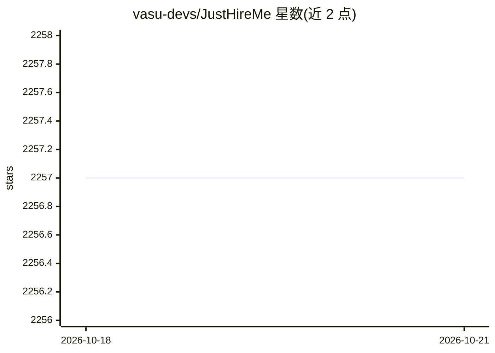

# vasu-devs/JustHireMe

⭐ 2,257 · Python · AGPL-3.0 · 推送 2026-10-09 · [GitHub](https://github.com/vasu-devs/JustHireMe) · [官网](https://www.JustHireMe.ai) · 个人维护

**本地优先的求职工作台：抓取职位、排序匹配度、生成定制申请材料**

面向求职者的 AGPL-3.0 本地优先桌面应用（Tauri + Python FastAPI sidecar）。从 ATS 看板、RSS、社区等多源抓取职位线索，经确定性质量门过滤后，用 Kuzu 图数据 + LanceDB 向量做可解释的匹配排序，并生成定制简历 PDF、求职信与外联草稿。默认零 API key：内置 ONNX 嵌入模型（all-MiniLM-L6-v2），LLM 步骤可由本地 Ollama 或现有 Claude Code / Codex CLI 订阅驱动；OpenAI、Anthropic 等密钥式提供方为可选。浏览器自动化/自动投递为实验性、默认关闭。提供 Windows/macOS/Linux 安装包。

## 筛选速览

| 维度 | 判定 | 备注 |
|---|---|---|
| AI 角色 | `ai-native` | 本体是模型或模型工具 |
| 许可风险 | `viral` | AGPL-3.0 |
| 部署形态 | `desktop` | 安装包/桌面程序 |
| 模型依赖 | local-ok | 支持本地模型 |
| 硬件要求 | — | 无带数字的原话,不猜 |
| 安装摩擦 | `low` | 无编译、无系统依赖或容器化 |
| 成熟度 | `idea` | |

## 能力要点

- 多源职位抓取 + 确定性质量门过滤 + 可解释排序
- Kuzu 图 + LanceDB 向量的 GraphRAG 匹配证明
- 本地 ONNX 嵌入模型，全离线语义匹配无需 API key
- 生成定制简历 PDF、求职信、冷邮件等申请材料

## 适用场景

- 从多个招聘渠道收集并筛选适合自己的职位
- 查看每个职位匹配得分背后的可解释依据
- 为心仪岗位一键生成定制的简历和求职信

## 场景标签

`语义搜索` `网页抓取` `AI 写作` · 领域:效率与自动化

## 证据(README 行号)

> L59: |Keyless by default|Discovery, ranking, and generation all run with zero API key — local Ollama or your existing Cl
> L109:  Generate Tailored Packages
> L163: |LLM providers|Keyless: Ollama, Claude Code CLI, Codex CLI. Keyed (optional): OpenAI, Anthropic, Gemini, Groq, Dee

## 星数曲线

2026-10-18 2,257 → 2026-10-21 2,257（+0）

---
*卡片 v1 · prompt 1.4 · 生成 2026-10-21 · 置信度 high · 依据 README sha `b9dbf431d35e` · [字段定义](../../DATASET.md)*
