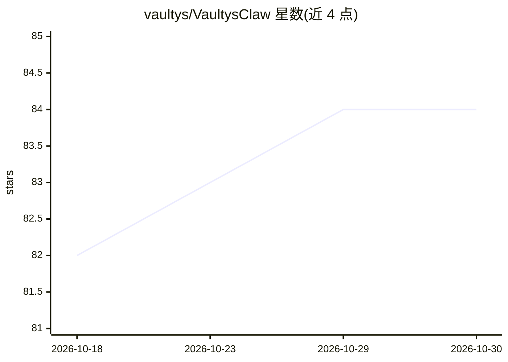

# vaultys/VaultysClaw

⭐ 84 · TypeScript · MIT · 推送 2026-10-29 · [GitHub](https://github.com/vaultys/VaultysClaw) · [官网](https://docs.vaultys.ai) · 组织维护

**面向 AI agent 的身份与访问控制平面，基于签名能力证书**

为运营者提供组织内人、agent、设备与传感器的身份管理：以 Actor 形式登记与审批成员，签发限定范围的能力证书（含到期与吊销），提供组织/工作区级紧急停用开关、操作台（actor 清单、传感器视图、地图、关系图与审计历史）、签名 webhook 与通知集成，以及 TypeScript/Go SDK。本地试用需 Docker Compose 2.24.4+ 与 OpenSSL，通过 quick-start 脚本启动。README 说明 SDK 权限判定需由消费应用或拦截点执行，登记 agent 本身不限制其机器上的任意进程；原 agent 控制器与工作流编辑器已不在支持架构内。

## 筛选速览

| 维度 | 判定 | 备注 |
|---|---|---|
| AI 角色 | `ai-ecosystem` | LLM/agent 周边工具 |
| 许可风险 | `permissive` | MIT |
| 部署形态 | `library` | 以包/库形式分发 |
| 模型依赖 | — | README 未给出锁定关系 |
| 硬件要求 | — | 无带数字的原话,不猜 |
| 安装摩擦 | `low` | 无编译、无系统依赖或容器化 |
| 成熟度 | — | 结构信号不足 |

## 能力要点

- 签名能力证书的访问控制：限定范围授权、到期、吊销与证书模板
- 组织与工作区级紧急停用开关（管理员豁免以便恢复）
- TypeScript 与 Go SDK，附权限/证书一致性测试夹具
- 含 Go 工作负载传感器与隔离控制平面上的舰队模拟器（7,000-actor 负载预设）

## 适用场景

- 为组织内的 AI agent、人员与设备统一发放和吊销最小权限凭证
- 审计 agent 的访问行为与能力证书变更历史
- 对失控 agent 执行工作区或组织级紧急停用
- 本地用 quick-start 脚本快速搭建零信任控制平面试用

## 场景标签

 · 领域:AI 安全/身份与访问管理

## 证据(README 行号)

> L3: Agent identity and access control, backed by a ledger of signed capability certificates.
> L5: VaultysClaw helps operators see which agents, people, devices and sensors belong to their
> L47: - **Identity and onboarding:** people, agents, sensors and devices represented as Actors, with ownership and regist

## 星数曲线

2026-10-18 82 → 2026-10-30 84（+2）

---
*卡片 v1 · prompt 1.4 · 生成 2026-10-24 · 置信度 mid · 依据 README sha `26571aaf2b80` · [字段定义](../../DATASET.md)*
