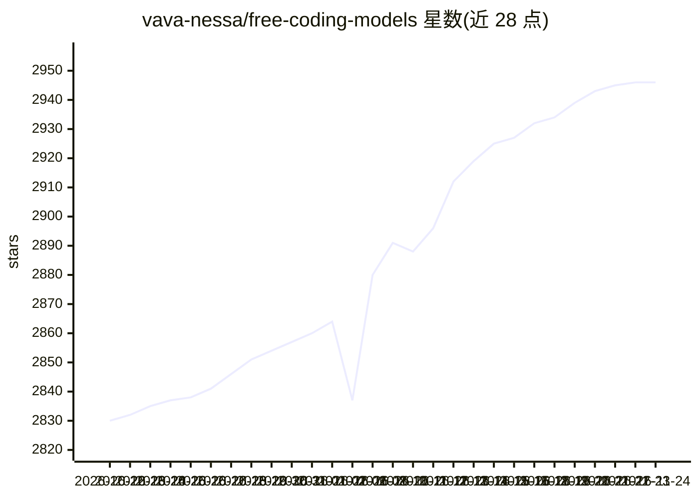

# vava-nessa/free-coding-models

⭐ 2,946 · HTML · NOASSERTION · 推送 2026-11-23 · [GitHub](https://github.com/vava-nessa/free-coding-models) · [官网](https://freecodingmodels.vercel.app) · 个人维护

**帮开发者实时测速并挑选免费编码 LLM 的 CLI 工具**

终端工具（含 Web Dashboard 与本地路由守护进程），对 22 个提供商的 222 个免费编码模型并行 ping，展示实时延迟与 0-100 稳定性评分（综合 p95 延迟、抖动、尖峰率与在线率），并基于 SWE-bench Verified 划分档位。选定后直接把模型写入 OpenCode、Goose、Crush、Aider 等编码工具的配置并启动。Node.js 18+ 通过 npm 安装，无需本地编译；支持自定义 OpenAI 兼容端点，界面提供英文与简体中文。

## 筛选速览

| 维度 | 判定 | 备注 |
|---|---|---|
| AI 角色 | `ai-ecosystem` | LLM/agent 周边工具 |
| 许可风险 | `none` | NOASSERTION |
| 部署形态 | `library` | 以包/库形式分发 |
| 模型依赖 | local-ok | 支持本地模型 |
| 硬件要求 | — | 无带数字的原话,不猜 |
| 安装摩擦 | `low` | 无编译、无系统依赖或容器化 |
| 成熟度 | — | 结构信号不足 |

## 能力要点

- 并行 ping 222 个模型，输出实时延迟与稳定性评分
- 选中模型后一键写入编码工具配置并启动
- 本地 OpenAI 兼容 Smart Model Router，含熔断与自动故障转移
- 支持添加 Ollama/LM Studio/vLLM 等自定义 OpenAI 兼容端点

## 适用场景

- 想快速找到当前延迟最低的免费编码模型
- 把免费模型一键接入 Aider、Cline、Goose 等编码工具
- 通过本地路由端点获得模型故障自动切换
- 把 Ollama 或 LM Studio 本地服务纳入统一测速与路由

## 场景标签

`模型网关` · 领域:Agent 开发

## 证据(README 行号)

> L6:  Live latency, stability and verdicts for 222 models from 22 providers, then install the one you pick straight into 
> L28: `free-coding-models` (FCM) answers that by pinging every model in parallel, showing live latency, and computing a *
> L30: Once you pick a model, FCM writes it directly into your coding tool's config and opens the tool, so you go from *"w

## 星数曲线

2026-10-22 2,830 → 2026-11-24 2,946（+116）

---
*卡片 v1 · prompt 1.4 · 生成 2026-11-23 · 置信度 high · 依据 README sha `16e037393a50` · [字段定义](../../DATASET.md)*
