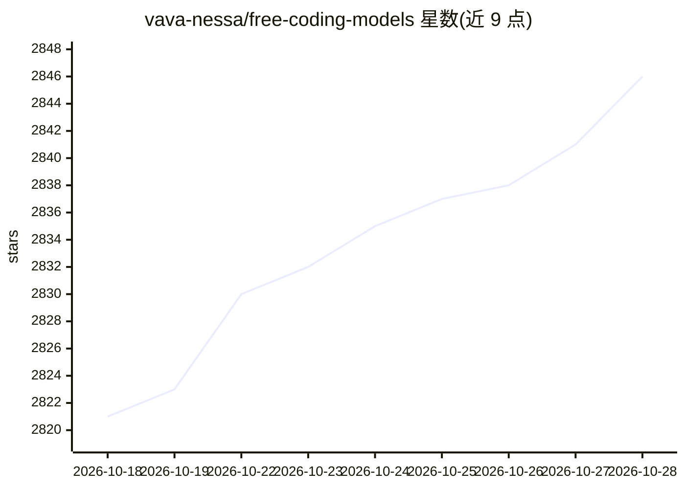

# vava-nessa/free-coding-models

⭐ 2,851 · HTML · NOASSERTION · 推送 2026-10-27 · [GitHub](https://github.com/vava-nessa/free-coding-models) · [官网](https://freecodingmodels.vercel.app) · 个人维护 · 中文 README

**免费编码模型实时测评与选型 CLI：252 模型延迟排名并写入工具配置**

面向编码模型选型的命令行工具：并行探测 24 个免费 provider 的 252 个模型，展示实时延迟、基于 p95 延迟/抖动/尖峰率/在线率的稳定性评分（0-100）及 SWE-bench 分层；选定后直接写入编码工具配置并启动，支持 OpenCode、Goose、Aider、Cline 等 21 个工具启动器。提供 TUI、Web Dashboard、OpenAI 兼容的本地路由守护进程（自动故障转移、熔断）及 OpenCode/Pi 插件。需 Node.js 18+，通过 npm 全局安装，各 provider 需自备免费 API key。

## 筛选速览

| 维度 | 判定 | 备注 |
|---|---|---|
| AI 角色 | `ai-ecosystem` | LLM/agent 周边工具 |
| 许可风险 | `none` | NOASSERTION |
| 部署形态 | `library` | 以包/库形式分发 |
| 模型依赖 | — | README 未给出锁定关系 |
| 硬件要求 | — | 无带数字的原话,不猜 |
| 安装摩擦 | `low` | 无编译、无系统依赖或容器化 |
| 成熟度 | — | 结构信号不足 |

## 能力要点

- 并行探测 24 provider / 252 模型，输出实时延迟与稳定性评分（0-100）
- 选定模型直接写入编码工具配置并启动（21 个工具启动器）
- 本地 OpenAI 兼容 Smart Model Router：自动故障转移、熔断、请求决策追踪
- Web Dashboard（端口 3333）支持 Docker 无头运行与可分享过滤链接

## 适用场景

- 我从 252 个免费编码模型里快速挑出当前最快最稳的一个
- 让我已装的编码工具（Aider/Cline/Goose 等）一键切换到选定模型
- 用一个本地路由端点聚合多个免费 provider 并自动故障转移

## 场景标签

`模型评测` `模型网关` · 领域:Agent 开发

## 证据(README 行号)

> L6:  Live latency, stability and verdicts for 252 models from 24 free AI providers, then install the one you pick straig
> L30: Once you pick a model, FCM writes it directly into your coding tool's config and opens the tool, so you go from *"w
> L128: A local OpenAI-compatible daemon: point any coding tool at `http://localhost:19280/v1` with model `fcm` (key `fcm-

## 星数曲线

2026-10-18 2,821 → 2026-10-28 2,846（+25）

---
*卡片 v1 · prompt 1.4 · 生成 2026-10-21 · 置信度 high · 依据 README sha `13a935ef7c01` · [字段定义](../../DATASET.md)*
