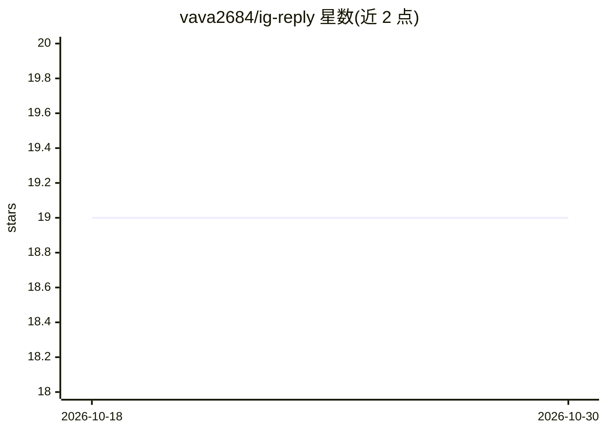

# vava2684/ig-reply

⭐ 19 · JavaScript · MIT · 推送 2026-08-01 · [GitHub](https://github.com/vava2684/ig-reply) · 个人维护 · 中文 README

**用你的 AI 助理回 Instagram 留言的抓取/送出工具，零付费 AI API**

Node.js 命令行工具，面向经营 Instagram 商业账号的创作者：程序仅负责抓取贴文留言、过滤已回复项并逐则送出回复，回复内容本身由用户在对话中使用自己的 AI 助理（如 Claude）生成，程序内不调用任何付费 AI 介面。流程分三段：fetch.js 产出待回清单 pending.json，AI 在对话里生成 replies.json，reply.js 逐则送出（每则间隔 30-90 秒）并用 replied.json 去重。附带 oauth.js 一键换取 60 天长期 Page Token。要求 IG 账号为商业账号并连结 Facebook 粉专，需 Node.js 18+ 与自建 Facebook App 凭证。

## 筛选速览

| 维度 | 判定 | 备注 |
|---|---|---|
| AI 角色 | `ai-native` | 本体是模型或模型工具 |
| 许可风险 | `permissive` | MIT |
| 部署形态 | `library` | 以包/库形式分发 |
| 模型依赖 | — | README 未给出锁定关系 |
| 硬件要求 | — | 无带数字的原话,不猜 |
| 安装摩擦 | `low` | 无编译、无系统依赖或容器化 |
| 成熟度 | — | 结构信号不足 |

## 能力要点

- 三段流程：fetch 抓留言 → AI 在对话生成回复 → reply 逐则送出，程序不内置 AI 调用
- 自动判定每则留言的回复语言，纯 emoji 留言按用户名推测语言、判不准回英语
- 每则回复间隔随机 30~90 秒，replied.json 记录去重
- oauth.js 走 Facebook Login 自动换取 60 天长期 Page Token

## 适用场景

- 国际化粉丝多的 IG 账号按留言者语言批量准备回复
- 在对话里用自有 AI 助理生成回复后由程序统一送出，控制语气与 CTA
- 需要避免重复回复同一则留言的留言运营

## 场景标签

`工作流自动化` · 领域:效率与自动化

## 证据(README 行号)

> L3: **用你的 AI 助理回 Instagram 留言 — 程式只抓資料和送出,回覆內容由 AI 在對話裡生成,零付費 AI API。**
> L39: ②  你的 AI 助理讀 pending.json,在對話裡逐則生成回覆   →   replies.json
> L40: ③  node reply.js            →   逐則送到 IG(每則間隔 30~90 秒,自動記錄已回)

## 星数曲线

2026-10-18 19 → 2026-10-30 19（+0）

---
*卡片 v1 · prompt 1.4 · 生成 2026-10-28 · 置信度 high · 依据 README sha `4dbc1a3e2bc2` · [字段定义](../../DATASET.md)*
