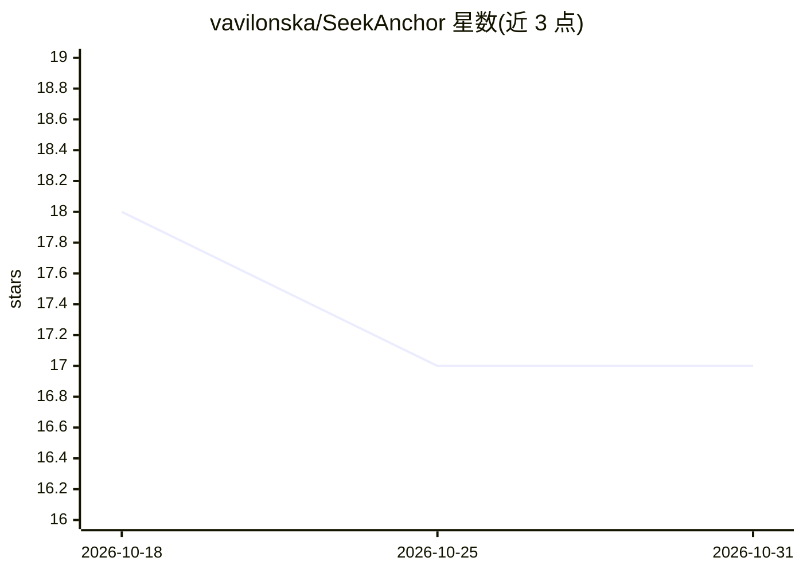

# vavilonska/SeekAnchor

⭐ 17 · TypeScript · MIT · 推送 2026-10-28 · [GitHub](https://github.com/vavilonska/SeekAnchor) · 个人维护 · 中文 README

**在 Pi/OMP/OpenCode 中引导 DeepSeek V4 Pro 推理轨迹的适配器**

为 Pi、Oh My Pi 与 OpenCode V2 beta 三个 coding agent 运行时提供 DSH Minimal 轨迹引导适配器：通过在模型派发前替换系统提示词与工具目录，促使 DeepSeek V4 Pro 的推理中出现 "We need"、"Let's" 等模式，无需显式要求模型产出这些短语。提供 native/minimal/anchor 三种模式与 A/B 变体，锚定后可恢复宿主提示词与工具。README 声明为实验性项目，不保证能力提升；测试、基准与日志等开发者材料与运行时分离，Codex 和 Claude Code 不在当前范围内。安装以复制运行时目录、PowerShell 脚本与 npm 依赖为主。

## 筛选速览

| 维度 | 判定 | 备注 |
|---|---|---|
| AI 角色 | `ai-ecosystem` | LLM/agent 周边工具 |
| 许可风险 | `permissive` | MIT |
| 部署形态 | `library` | 以包/库形式分发 |
| 模型依赖 | locked-api |  |
| 硬件要求 | — | 无带数字的原话,不猜 |
| 安装摩擦 | `low` | 无编译、无系统依赖或容器化 |
| 成熟度 | `idea` | |

## 能力要点

- 三个运行时适配器：Pi、Oh My Pi（.omp 独立副本）、OpenCode V2 beta 插件
- native/minimal/anchor 模式与 A/B 锚定变体，按会话维护锚定状态
- OpenCode 后端可在保持原生 shell 执行器与权限生命周期的同时收窄模型可见 schema
- 适配指南要求复现模型可见组合而非仅追加提示词指令

## 适用场景

- 在 Pi/OMP/OpenCode 中让 DeepSeek V4 Pro 呈现 DSH Minimal 推理轨迹
- 对照实验：用 anchor 模式与禁用插件构成控制组比较效果
- 参考其适配原则为其他 coding agent 编写同类轨迹引导插件

## 场景标签

`提示工程` · 领域:Agent 开发

## 证据(README 行号)

> L11: SeekAnchor steers DeepSeek V4 Pro toward the DSH Minimal agent trajectory. It
> L15: The project currently provides three runtime adapters:
> L306: An adapter for another agent should reproduce the model-visible composition,

## 星数曲线

2026-10-18 18 → 2026-10-31 17（-1）

---
*卡片 v1 · prompt 1.4 · 生成 2026-10-29 · 置信度 high · 依据 README sha `d99e34f890e3` · [字段定义](../../DATASET.md)*
