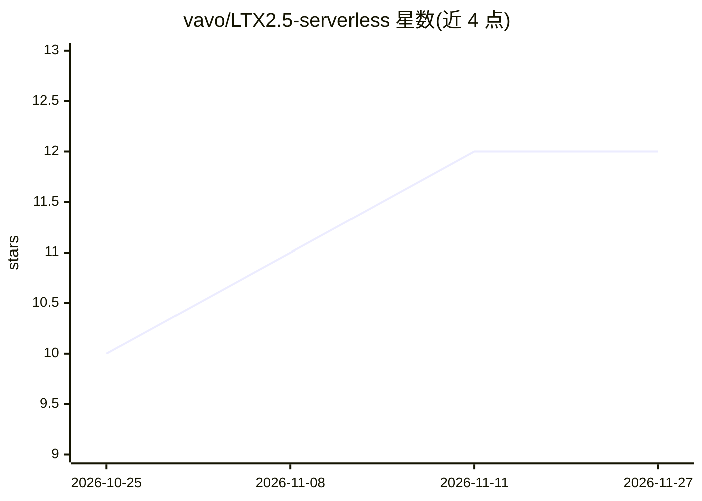

# vavo/LTX2.5-serverless

⭐ 12 · Python · MIT · 推送 2026-11-17 · [GitHub](https://github.com/vavo/LTX2.5-serverless) · [官网](https://get.runpod.io/ltx25-pod-and-serverless) · 个人维护

**在 RunPod 上以 serverless 或 Pod 方式运行 LTX 2.5 视频生成**

面向 RunPod 平台的 LTX 2.5 文生视频与图生视频部署模板：既可部署为 serverless worker，通过 /run 与 /runsync 端点接收 ComfyUI API 格式工作流，也可作为交互式 Pod 启动，内置简洁 Web 前端（端口 7777）与完整 ComfyUI 画布（端口 8188）。使用蒸馏 INT8 模型配置，首次启动自动下载模型到 /workspace 持久存储，启动时校验模型是否可被 ComfyUI 索引。要求 48 GB 以上显存的 GPU、100 GB 持久存储及 Hugging Face 访问令牌。

## 筛选速览

| 维度 | 判定 | 备注 |
|---|---|---|
| AI 角色 | `ai-native` | 本体是模型或模型工具 |
| 许可风险 | `permissive` | MIT |
| 部署形态 | `self-host` | docker 或自建部署 |
| 模型依赖 | — | README 未给出锁定关系 |
| 硬件要求 | `gpu-24g` | |
| 安装摩擦 | `low` | 无编译、无系统依赖或容器化 |
| 成熟度 | — | 结构信号不足 |

## 能力要点

- 同时提供 serverless worker 与交互式 Pod 两种部署方式
- 内置文生视频/图生视频 Web 前端与 ComfyUI 可视化工作流编辑
- 首次启动自动下载模型并校验 transformer、文本编码器、VAE 等组件可被索引
- 模型、Python 环境与缓存放置于 /workspace 持久存储

## 适用场景

- 通过 RunPod API 提交文本或图片生成视频的任务
- 在交互式 Pod 中用 ComfyUI 编辑和运行 LTX 2.5 工作流
- 用前端快速生成不同时长与宽高比的视频
- 为应用搭建可按需扩缩的视频生成 API 服务

## 场景标签

`视频生成` · 领域:内容生成

## 证据(README 行号)

> L5: Generate LTX 2.5 text-to-video and image-to-video on RunPod without rebuilding the same GPU environment every time. 
> L9: - LTX 2.5 distilled INT8 inference tuned for modern NVIDIA GPUs

## 星数曲线

2026-10-25 10 → 2026-11-27 12（+2）

---
*卡片 v1 · prompt 1.4 · 生成 2026-11-18 · 置信度 high · 依据 README sha `3e40765affd7` · [字段定义](../../DATASET.md)*
