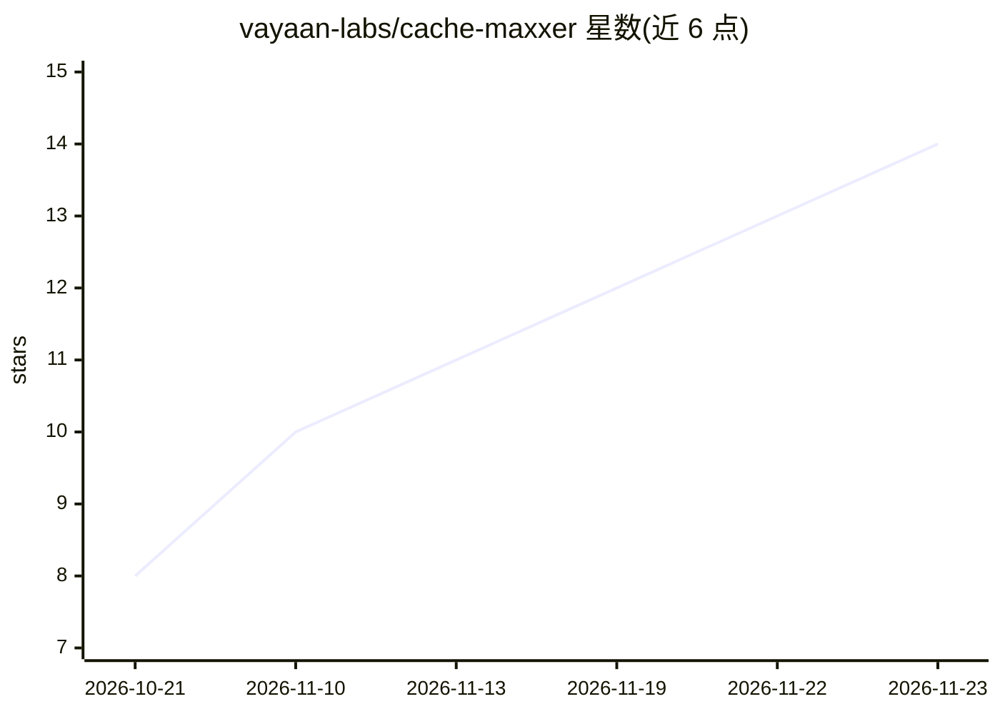

# vayaan-labs/cache-maxxer

⭐ 14 · TypeScript · MIT · 推送 2026-10-09 · [GitHub](https://github.com/vayaan-labs/cache-maxxer) · 组织维护

**为 Claude Code 用户保持提示缓存温热的插件，降低重读会话成本**

一个 Claude Code 插件：在输入框上方显示提示缓存的剩余时间与缓存命中率，解释每次缓存重建的原因（离开过久、切换模型、压缩/清除、系统提示或工具变化）。提供 Keep warm 功能在缓存到期前发送一个小请求重置计时器，并可展示会话统计、最近 10 次请求与按 Anthropic 价格表计算的读写费用。要求 Claude Code 2.1.289 及以上，支持终端与桌面应用，当前标注支持 macOS；无服务器、无账号，最多每天读取一次 Anthropic 公开价格页。

## 筛选速览

| 维度 | 判定 | 备注 |
|---|---|---|
| AI 角色 | `ai-ecosystem` | LLM/agent 周边工具 |
| 许可风险 | `permissive` | MIT |
| 部署形态 | `None` |  |
| 模型依赖 | locked-api |  |
| 硬件要求 | — | 无带数字的原话,不猜 |
| 安装摩擦 | `low` | 无编译、无系统依赖或容器化 |
| 成熟度 | — | 结构信号不足 |

## 能力要点

- 输入框上方实时显示缓存剩余时间倒计时与命中率（精确到两位小数）
- 每次缓存重建给出原因与成本说明
- Keep warm 在到期前自动发送小请求续期缓存，3 小时无消息自动停止
- 按 Anthropic 公开价格表（每日更新一次）计算缓存读写的节省金额

## 适用场景

- 长时间使用 Claude Code 时避免缓存过期后整段会话重写计费
- 查看会话的缓存命中率与费用节省明细
- 排查缓存为何被重建（压缩、换模型、设置变更等）

## 场景标签

`LLM 可观测性` · 领域:评测与运维

## 证据(README 行号)

> L5: **A Claude Code mod that keeps your cache warm, so you pay 96% less to re-read your conversation.**
> L15: Claude Code keeps a saved copy of your conversation, the prompt cache, so each new message doesn't pay full price t
> L17: Cache Maxxer adds a thin band right above your input box with the time left on that cache and your hit rate, which 

## 星数曲线

2026-10-21 8 → 2026-11-23 14（+6）

---
*卡片 v1 · prompt 1.4 · 生成 2026-11-18 · 置信度 high · 依据 README sha `7c95ccdeb5df` · [字段定义](../../DATASET.md)*
