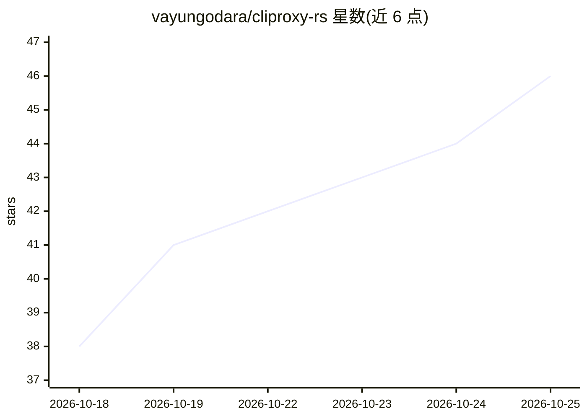

# vayungodara/cliproxy-rs

⭐ 46 · Rust · NOASSERTION · 推送 2026-10-25 · [GitHub](https://github.com/vayungodara/cliproxy-rs) · 个人维护

**本地 LLM API 代理：让 Codex CLI、Claude Code 用 DeepSeek/GLM/Kimi 等模型**

CLIProxyAPI 的 Rust 重写版，兼容目标冻结在 Go v8.0.35，读取相同的 config.yaml 与凭据格式并实现 v8 Management API。提供单一本地端点，把 OpenAI、Anthropic、Gemini 三种 API 互译，使 Codex CLI、Claude Code 等工具可接入 DeepSeek、GLM、Kimi、OpenRouter 等提供商或自有网关；支持多账号凭据轮换、429 冷却故障转移、仪表盘与终端 TUI。对 Go 版对等性未完成：审计 1,951 项中 1,015 覆盖、895 部分、41 缺失。面向单人自有账号自用场景。

## 筛选速览

| 维度 | 判定 | 备注 |
|---|---|---|
| AI 角色 | `ai-ecosystem` | LLM/agent 周边工具 |
| 许可风险 | `none` | NOASSERTION |
| 部署形态 | `None` |  |
| 模型依赖 | locked-api |  |
| 硬件要求 | — | 无带数字的原话,不猜 |
| 安装摩擦 | `low` | 无编译、无系统依赖或容器化 |
| 成熟度 | — | 结构信号不足 |

## 能力要点

- OpenAI/Anthropic/Gemini 三种 API 协议互译，单端点混用多提供商
- 多凭据路由（round-robin/weighted 等）与 429 自动切换
- 内置仪表盘：账号、提供商限额、请求历史与工具配置
- 与 Go CLIProxyAPI 的配置、凭据与 Management API 兼容

## 适用场景

- 让 Codex CLI 接入只提供 Chat Completions 的模型端点
- 把多个提供商和密钥聚合到一个本地端点供 Claude Code 等工具使用
- 多账号间轮换凭据并在 429 时自动故障转移

## 场景标签

`模型网关` · 领域:Agent 开发

## 证据(README 行号)

> L7: One local endpoint so Codex CLI, Claude Code and other tools can use DeepSeek, GLM, Kimi, OpenRouter or your own gat
> L49: cliproxy-rs is a Rust rewrite of CLIProxyAPI, with the compatibility target frozen at Go v8.0.35. It reads the same
> L60: The local OpenAI base URL is `http://127.0.0.1:8317/v1`. Claude Code and Gemini clients use `http://127.0.0.1:8317`

## 星数曲线

2026-10-18 38 → 2026-10-25 46（+8）

---
*卡片 v1 · prompt 1.4 · 生成 2026-10-25 · 置信度 high · 依据 README sha `7e69193fd9ff` · [字段定义](../../DATASET.md)*
