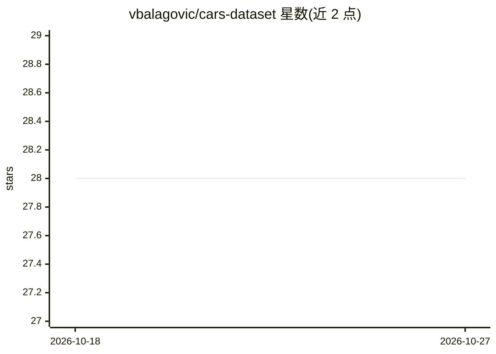

# vbalagovic/cars-dataset

⭐ 28 · 推送 2026-07-08 · [GitHub](https://github.com/vbalagovic/cars-dataset) · 个人维护

**汽车/卡车/摩托车规格与市场价格数据集（含 API）**

覆盖 1898–2026 年、370+ 品牌共 54,000+ 车型变体的车辆规格数据库：汽车 47,344 条、卡车 5,492 条、摩托车 1,858 条，每条含 40+ 规格字段与平均 84 项配置特征；另含 105,000+ 来自 11 个欧洲国家的真实市场价格挂牌。仓库内仅提供 CSV/JSON 采样数据（各 30-37 条）供评估，完整数据需付费一次性购买，另有按月订阅的 API（含免费 preview 端点）。数据集为专有许可。

## 筛选速览

| 维度 | 判定 | 备注 |
|---|---|---|
| AI 角色 | `ai-knowledge` | 知识聚合/清单类 |
| 许可风险 | `none` | — |
| 部署形态 | `None` |  |
| 模型依赖 | — | README 未给出锁定关系 |
| 硬件要求 | — | 无带数字的原话,不猜 |
| 安装摩擦 | `low` | 无编译、无系统依赖或容器化 |
| 成熟度 | — | 结构信号不足 |

## 能力要点

- 54,694 个车型变体、370+ 品牌，覆盖 1898–2026 年
- 每车含 40+ 规格字段与平均 84 项配置特征数组
- 105,000+ 欧洲市场价格挂牌（11 国、419 品牌）
- 提供免费 preview API 端点（无需 key）与仓库内评估采样数据

## 适用场景

- 开发车辆查询应用或接入车辆规格 API
- 做汽车价格分析或市场研究的数据来源
- 为 AI/ML 项目获取结构化车辆规格训练数据

## 场景标签

 · 领域:汽车/数据集

## 证据(README 行号)

> L5: Vehicle specifications database -- **54,000+ variants** across **370+ brands**. Cars, trucks & motorcycles. Plus **1
> L10: |Dataset|Variants|Brands|Year Range|Spec Fields|
> L236: This repository contains sample data for evaluation:

## 星数曲线

2026-10-18 28 → 2026-10-27 28（+0）

---
*卡片 v1 · prompt 1.4 · 生成 2026-10-26 · 置信度 high · 依据 README sha `3fa0c97c405d` · [字段定义](../../DATASET.md)*
