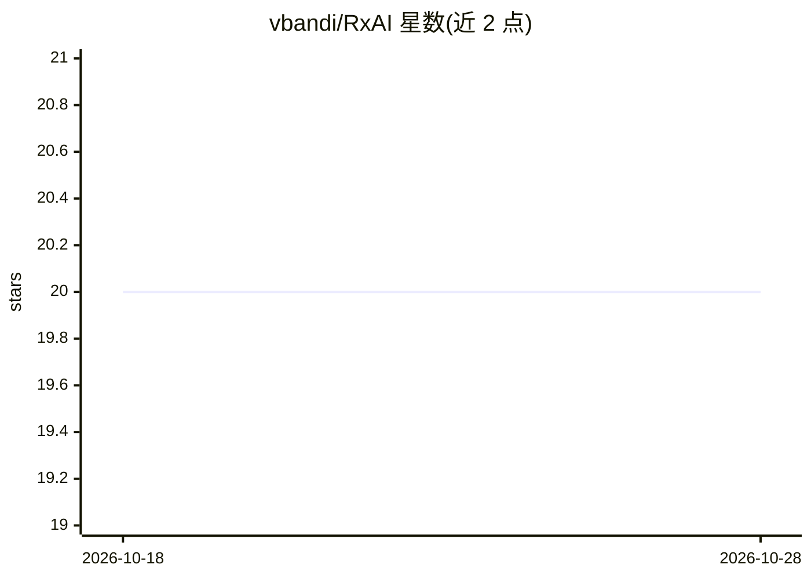

# vbandi/RxAI

⭐ 20 · C# · MIT · 推送 2025-11-26 · [GitHub](https://github.com/vbandi/RxAI) · 个人维护

**C# 响应式库：用 Rx.Net 接入 OpenAI/Azure Realtime API**

基于 Reactive Extensions (Rx) 的 C# 库，封装 OpenAI 与 Azure OpenAI Realtime API，提供 RealtimeConversationClientRX 类实现实时语音对话。功能包括音频输入输出、函数调用扩展、内置成本追踪与可定制对话选项。面向 .NET 开发者构建实时交互式 AI 应用。安装需克隆仓库、添加项目引用并安装 NuGet 依赖（OpenAI、System.Reactive 等），随附控制台 Demo 展示麦克风对话与函数调用。MIT 许可。

## 筛选速览

| 维度 | 判定 | 备注 |
|---|---|---|
| AI 角色 | `ai-ecosystem` | LLM/agent 周边工具 |
| 许可风险 | `permissive` | MIT |
| 部署形态 | `None` |  |
| 模型依赖 | locked-api |  |
| 硬件要求 | — | 无带数字的原话,不猜 |
| 安装摩擦 | `medium` | 含编译或系统依赖之一 |
| 成熟度 | — | 结构信号不足 |

## 能力要点

- 以 Rx 响应式模型封装 Realtime API 的实时语音对话
- 支持函数调用扩展与自定义 Calculator 示例
- 内置成本追踪与展示
- 提供音频输入输出与转写事件订阅

## 适用场景

- 在 .NET 应用中构建 OpenAI/Azure Realtime 实时语音对话
- 以响应式编程方式订阅转写、函数调用与成本事件
- 参考 ConsoleDemo 学习 Realtime API 的接入方式

## 场景标签

`语音 Agent` · 领域:对话与助手

## 证据(README 行号)

> L3: RxAI is a C# library that provides a reactive programming interface for interacting with OpenAI and Azure Realtime A
> L7: - Use the Realtime API from OpenAI and Azure OpenAI with a reactive (RX.Net) programming model

## 星数曲线

2026-10-18 20 → 2026-10-28 20（+0）

---
*卡片 v1 · prompt 1.4 · 生成 2026-10-28 · 置信度 high · 依据 README sha `8062df222887` · [字段定义](../../DATASET.md)*
