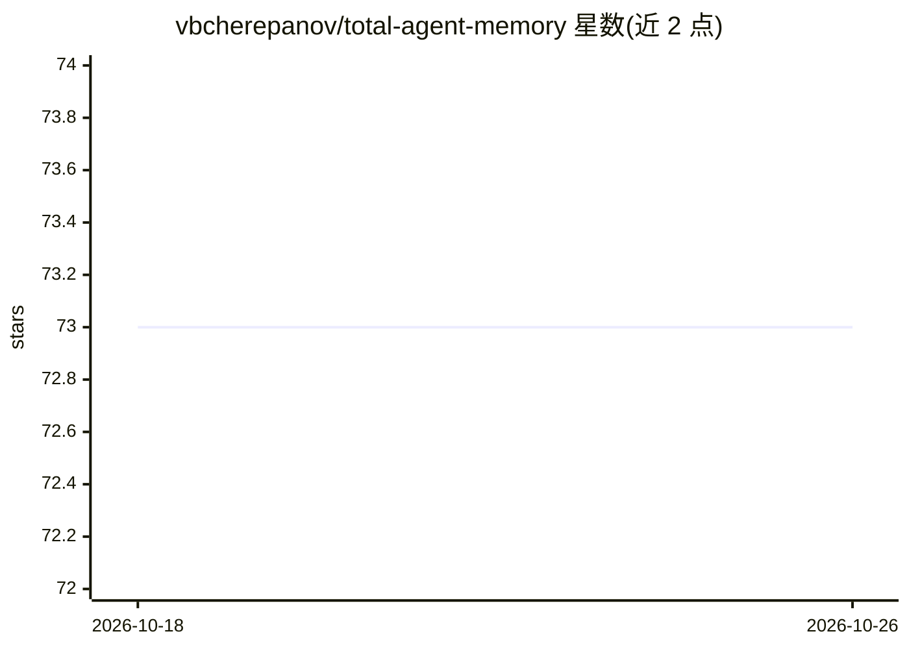

# vbcherepanov/total-agent-memory

⭐ 73 · Python · MIT · 推送 2026-10-14 · [GitHub](https://github.com/vbcherepanov/total-agent-memory) · [官网](https://totalmemory.dev) · 个人维护

**面向 AI 编程代理的本地持久记忆 MCP 服务器**

开源记忆服务器，通过 MCP 为 Claude Code、Codex CLI、Cursor 等编程代理提供跨会话的本地持久记忆，存储决策、修复、事实与错误并在后续会话中检索。每个存储是一个基于 SQLite 的目录，检索融合 BM25 全文、本地稠密向量、模糊匹配与知识图（倒数排序融合），事实可带有效期。默认配置在写入与搜索时不调用 LLM，结果可离线复现。面向日常使用编程代理的开发者与需要可本地运行的记忆基线的研究者，也可作为团队服务器运行。提供 79 个 MCP 工具与仪表盘。

## 筛选速览

| 维度 | 判定 | 备注 |
|---|---|---|
| AI 角色 | `ai-ecosystem` | LLM/agent 周边工具 |
| 许可风险 | `permissive` | MIT |
| 部署形态 | `self-host` | docker 或自建部署 |
| 模型依赖 | — | README 未给出锁定关系 |
| 硬件要求 | — | 无带数字的原话,不猜 |
| 安装摩擦 | `low` | 无编译、无系统依赖或容器化 |
| 成熟度 | — | 结构信号不足 |

## 能力要点

- BM25+本地稠密向量+模糊匹配+知识图的倒数排序融合检索
- 默认配置写入与搜索均不调用 LLM，结果确定性可复现
- 事实支持有效期，新值可退休旧值（kg_add_fact / kg_at）
- 可作团队服务器：个人/部门/公司分区、角色、审计跟踪

## 适用场景

- 让编程代理在后续会话中记住项目决策与约定
- 本地运行、可检查可修改的记忆检索研究基线
- 团队共享记忆并按角色与作者管理、留审计记录

## 场景标签

`Agent 记忆` · 领域:Agent 开发

## 证据(README 行号)

> L18: through the Model Context Protocol (MCP), so
> L21: Each store is one directory built around a SQLite database. Recall combines

## 星数曲线

2026-10-18 73 → 2026-10-26 73（+0）

---
*卡片 v1 · prompt 1.4 · 生成 2026-10-24 · 置信度 high · 依据 README sha `669f2bfe2a73` · [字段定义](../../DATASET.md)*
