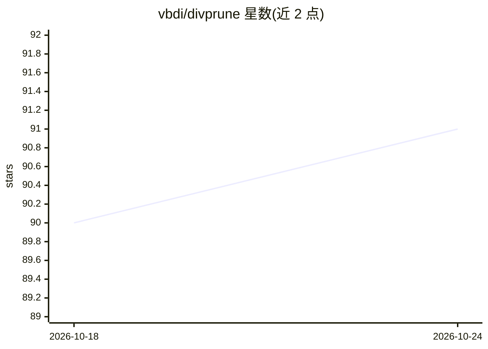

# vbdi/divprune

⭐ 91 · Python · NOASSERTION · 推送 2026-04-16 · [GitHub](https://github.com/vbdi/divprune) · 个人维护

**面向大型多模态模型的多样性视觉 token 剪枝方法（CVPR 2025）**

CVPR 2025 论文 DivPrune 的官方代码库：基于多样性的视觉 token 剪枝方法，用于降低大型多模态模型（默认 LLaVA-1.5 7B）的推理计算量。提供复现论文结果的脚本（默认保留比例 0.098）、TFLOPs 计算脚本以及基于 LLaVA-1.6 的显存与延迟评测脚本；代码基于 lmms-eval、LLaVA 与 FASTV 实现。社区贡献包含 Gemma 4 与 Qwen2.5-VL 的适配。许可证为 CC BY-NC 4.0（非商业）。

## 筛选速览

| 维度 | 判定 | 备注 |
|---|---|---|
| AI 角色 | `ai-ecosystem` | LLM/agent 周边工具 |
| 许可风险 | `none` | NOASSERTION |
| 部署形态 | `None` |  |
| 模型依赖 | — | README 未给出锁定关系 |
| 硬件要求 | — | 无带数字的原话,不猜 |
| 安装摩擦 | `medium` | 含编译或系统依赖之一 |
| 成熟度 | — | 结构信号不足 |

## 能力要点

- 基于多样性的视觉 token 剪枝，默认保留比例 0.098
- 提供论文结果复现脚本与 TFLOPs/显存/延迟评测脚本
- 默认支持 LLaVA-1.5 7B，社区贡献 Gemma 4 与 Qwen2.5-VL 适配
- 提供华为 AI Gallery Notebook 入口

## 适用场景

- 复现 CVPR 2025 DivPrune 论文实验结果
- 在 LLaVA 等多模态模型上做视觉 token 剪枝以降低推理开销
- 测量不同剪枝比例下的计算量、显存与延迟

## 场景标签

`模型量化` · 领域:训练与推理

## 证据(README 行号)

> L1: # DivPrune
> L22: The default pretrained model is set to LLaVA 1.5 7b. Feel free to change the pre-trained model to get the results w
> L48: The code is implemented based on lmms-eval, LLaVA and FASTV.

## 星数曲线

2026-10-18 90 → 2026-10-24 91（+1）

---
*卡片 v1 · prompt 1.4 · 生成 2026-10-23 · 置信度 high · 依据 README sha `00165e312e9e` · [字段定义](../../DATASET.md)*
