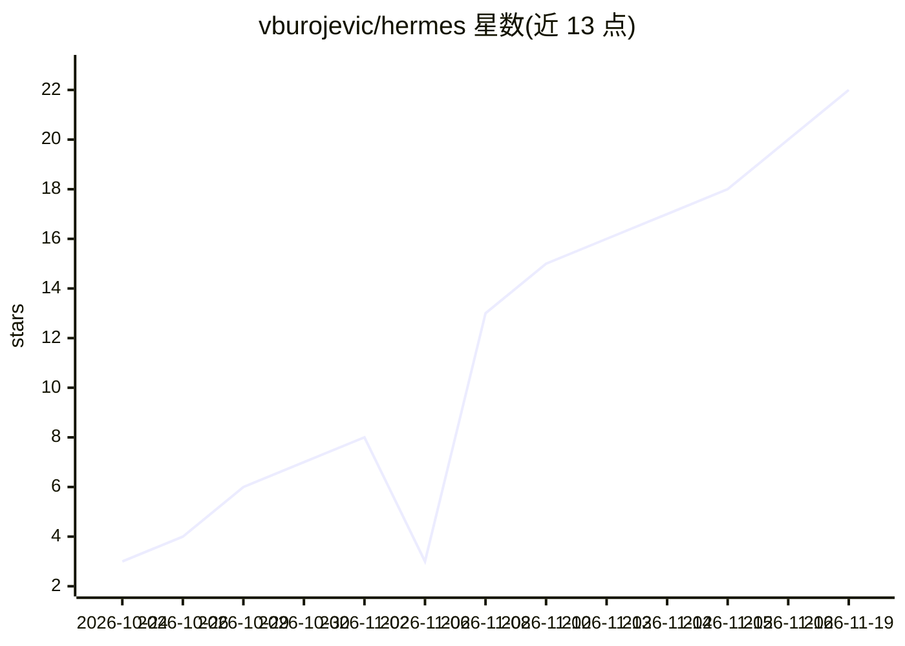

# vburojevic/hermes

⭐ 22 · Swift · MIT · 推送 2026-11-18 · [GitHub](https://github.com/vburojevic/hermes) · [官网](https://hermesapp.dev) · 个人维护

**连接自托管 Hermes Agent 的 iPhone/iPad/Mac 原生客户端**

用 Swift 6/SwiftUI 编写的多平台原生应用，作为用户在自有设备上运行的开源 Hermes Agent（Nous Research）的客户端：流式查看 agent 的每一步搜索、命令与文件改动，支持锁屏审批命令、语音消息、Bot 多档案（各自面孔/记忆/会话）、项目看板、Inspector 查看页面/文件/终端等。只与用户自己的 Hermes 网关通信，无账号无分析；通知端到端加密。需用户自行部署 Hermes Agent 及 hermes serve 后端；当前为公共测试版，iOS/iPadOS/macOS 26 起。

## 筛选速览

| 维度 | 判定 | 备注 |
|---|---|---|
| AI 角色 | `ai-ecosystem` | LLM/agent 周边工具 |
| 许可风险 | `permissive` | MIT |
| 部署形态 | `None` |  |
| 模型依赖 | — | README 未给出锁定关系 |
| 硬件要求 | — | 无带数字的原话,不猜 |
| 安装摩擦 | `medium` | 含编译或系统依赖之一 |
| 成熟度 | `idea` | |

## 能力要点

- 流式展示 agent 每一步搜索、命令与文件改动，支持锁屏审批与 Dynamic Island
- Bot 多档案体系：各自面孔、记忆、独立会话、群聊与例行任务
- 附带 Hermes 插件：端到端加密推送通知与交互式小组件
- 只连接用户自建网关，无账号、无分析、无第三方 SDK（iOS/iPadOS）

## 适用场景

- 在手机上随时查看并审批家中服务器上 agent 的操作
- 用语音与多个 Bot 档案对话并管理其记忆
- 通过看板向 agent 派发任务并用 Inspector 盯进度

## 场景标签

`AI 助手` · 领域:对话与助手

## 证据(README 行号)

> L7: A native iPhone, iPad and Mac app for the Hermes Agent you run.
> L31: Hermes Agent is the open-source agent by Nous Research that
> L33: on a schedule. **Hermes** puts it in your hand. It talks only to your own Hermes, with no account and

## 星数曲线

2026-10-24 3 → 2026-11-19 22（+19）

---
*卡片 v1 · prompt 1.4 · 生成 2026-11-18 · 置信度 high · 依据 README sha `3659167cbc43` · [字段定义](../../DATASET.md)*
