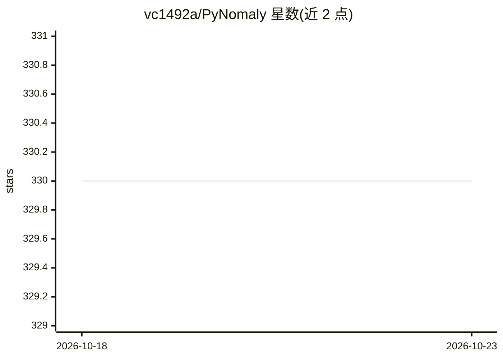

# vc1492a/PyNomaly

⭐ 330 · Python · NOASSERTION · 推送 2026-09-22 · [GitHub](https://github.com/vc1492a/PyNomaly) · 个人维护

**LoOP 局部离群概率异常检测的 Python 实现**

Python 3 库，实现 Kriegel 等人提出的 LoOP（Local Outlier Probabilities）局部密度异常检测方法：基于 k 近邻距离计算每个样本的离群概率，输出 [0,1] 区间内可直接解释为离群概率的分数。支持 cluster_labels 按簇计算、extent/n_neighbors 参数调节、可选 Numba JIT 加速与多核并行、进度条与自定义异常体系。需 Python 3.8-3.14 与 numpy；输入需预处理缺失值与尺度归一化。是 deepchecks、OmniDocBench、pysad 的核心依赖库。

## 筛选速览

| 维度 | 判定 | 备注 |
|---|---|---|
| AI 角色 | `ai-native` | 本体是模型或模型工具 |
| 许可风险 | `none` | NOASSERTION |
| 部署形态 | `library` | 以包/库形式分发 |
| 模型依赖 | — | README 未给出锁定关系 |
| 硬件要求 | — | 无带数字的原话,不猜 |
| 安装摩擦 | `low` | 无编译、无系统依赖或容器化 |
| 成熟度 | — | 结构信号不足 |

## 能力要点

- 输出 [0,1] 区间可直接解释为离群概率的归一化分数
- 支持 cluster_labels 按簇计算以处理不同密度区域
- 可选 Numba JIT 与 n_jobs 多核并行（报告 2-3x 加速）
- 提供自定义异常（MissingValuesError、ClusterSizeError 等）与进度条

## 适用场景

- 对我的数据集做基于局部密度的异常检测并得到概率化分数
- 在聚类结果上按簇计算离群概率以处理多密度数据
- 将异常检测能力作为依赖嵌入我的 ML 流水线

## 场景标签

 · 领域:机器学习/异常检测

## 证据(README 行号)

> L3: PyNomaly is a Python 3 implementation of LoOP (Local Outlier Probabilities).
> L20: The outlier score of each sample is called the Local Outlier Probability.

## 星数曲线

2026-10-18 330 → 2026-10-23 330（+0）

---
*卡片 v1 · prompt 1.4 · 生成 2026-10-21 · 置信度 high · 依据 README sha `be3629f79522` · [字段定义](../../DATASET.md)*
