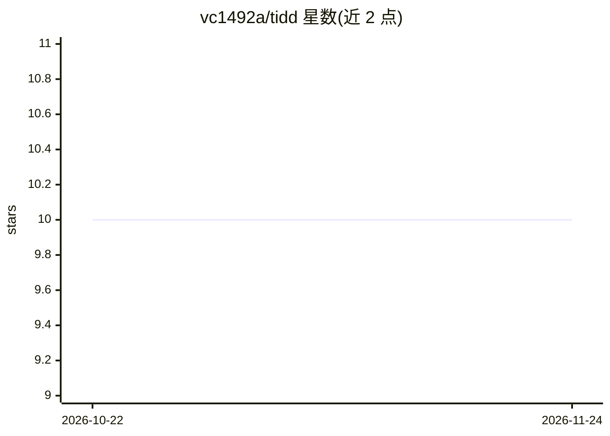

# vc1492a/tidd

⭐ 10 · Jupyter Notebook · NOASSERTION · 推送 2026-06-17 · [GitHub](https://github.com/vc1492a/tidd) · 组织维护

**面向科研人员的 GNSS 电离层扰动（海啸等）检测工具包**

TIDD 是检测海啸、地震、大爆炸等引发的行进式电离层扰动（TID）的工具包，由 NASA JPL、罗马 Sapienza 大学与 UCLA 合作开发。机制：将 GNSS 卫星 sTEC d/dt 时间序列经 Gramian Angular Difference Fields 编码为图像，训练 CNN 进行 TID 检测；单次浮点数据到预测约需 1.1 秒。附带 2012 年夏威夷海啸与 2015 年智利地震的实验数据、Jupyter notebooks 与单元测试。Python 版本要求 3.5–3.8；notebook 部分可视化依赖 geos 库。

## 筛选速览

| 维度 | 判定 | 备注 |
|---|---|---|
| AI 角色 | `ai-native` | 本体是模型或模型工具 |
| 许可风险 | `none` | NOASSERTION |
| 部署形态 | `library` | 以包/库形式分发 |
| 模型依赖 | — | README 未给出锁定关系 |
| 硬件要求 | — | 无带数字的原话,不猜 |
| 安装摩擦 | `low` | 无编译、无系统依赖或容器化 |
| 成熟度 | — | 结构信号不足 |

## 能力要点

- GADF 将 sTEC 时间序列编码为图像供 CNN 训练
- 支持从浮点数据到 TID 存在性预测的实时流程（约 1.1 秒）
- 附带夏威夷 2012 海啸与智利 2015 地震的 sTEC 数据集
- 验证集指标：recall 84.6%、precision 100%、F1 91.7%

## 适用场景

- 基于 GNSS 接收机数据检测海啸相关的电离层扰动
- 复现或扩展论文中的 CNN 时间序列异常检测实验
- 处理和可视化 sTEC 时序数据的科研工作流

## 场景标签

`科研工具` · 领域:学习与行业

## 证据(README 行号)

> L28: for TID detection. This toolkit demonstrates the effectiveness of training a convolutional neural network (CNN) to
> L29: detect signs of IGWs. The approach utilized in this toolkit employs Gramian Angular Difference Fields (GADFs) to
> L36: In a real-time system, slant Total Electron Content (sTEC) may be calculated, windowed, converted

## 星数曲线

2026-10-22 10 → 2026-11-24 10（+0）

---
*卡片 v1 · prompt 1.4 · 生成 2026-11-19 · 置信度 high · 依据 README sha `19e640e42569` · [字段定义](../../DATASET.md)*
