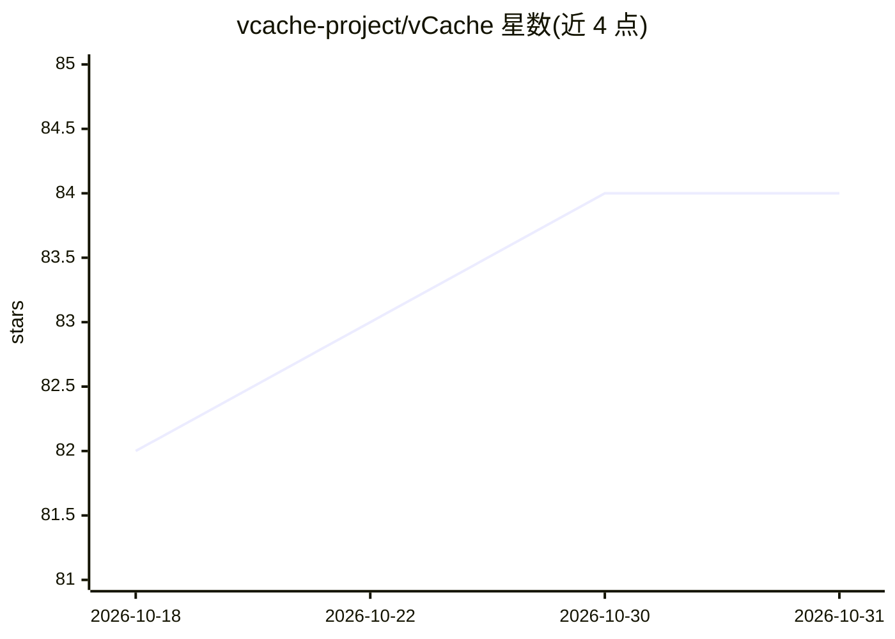

# vcache-project/vCache

⭐ 84 · Python · NOASSERTION · 推送 2026-07-30 · [GitHub](https://github.com/vcache-project/vCache) · 组织维护

**带错误率上界保证的 LLM 语义提示缓存库**

部署在应用服务器与 LLM 推理后端之间的 Python 语义缓存库：对语义相似的提示返回缓存回答以降低延迟与调用成本。核心机制是用在线学习、嵌入相关的决策边界替代静态阈值，从而在用户设定的错误率上界（如 1%）内最大化缓存命中。默认使用 OpenAI 做推理与嵌入，组件（向量库 HNSWLib、淘汰策略 FIFO/LRU/MRU/SCU 等）均可替换。README 声明处于活跃开发期，API 可能变化。附论文（arXiv:2502.03771）、playground 示例与四个开放基准。

## 筛选速览

| 维度 | 判定 | 备注 |
|---|---|---|
| AI 角色 | `ai-ecosystem` | LLM/agent 周边工具 |
| 许可风险 | `none` | NOASSERTION |
| 部署形态 | `library` | 以包/库形式分发 |
| 模型依赖 | — | README 未给出锁定关系 |
| 硬件要求 | — | 无带数字的原话,不猜 |
| 安装摩擦 | `low` | 无编译、无系统依赖或容器化 |
| 成熟度 | `idea` | |

## 能力要点

- 用户可设定错误率上界并强制执行
- 在线学习的嵌入相关决策边界，无需手动微调
- 模块化组件：推理/嵌入引擎、向量库、淘汰策略可替换
- 内置基准框架与四个开放基准数据集

## 适用场景

- 降低 LLM API 调用成本与响应延迟
- 在 agentic/RAG/LLM SQL 查询系统中复用语义等价回答
- 为语义缓存方案评估命中率与错误率

## 场景标签

 · 领域:LLM 基础设施/缓存

## 证据(README 行号)

> L9: vCache is the first semantic prompt cache that guarantees user-defined error rate bounds. Semantic caching reduces L
> L57: Semantic caches sit between the application server and the LLM inference backend.
> L61: Applications can range from agentic systems and RAG pipelines to database systems issuing LLM-based SQL queries. Th

## 星数曲线

2026-10-18 82 → 2026-10-31 84（+2）

---
*卡片 v1 · prompt 1.4 · 生成 2026-10-24 · 置信度 mid · 依据 README sha `89e570d21493` · [字段定义](../../DATASET.md)*
