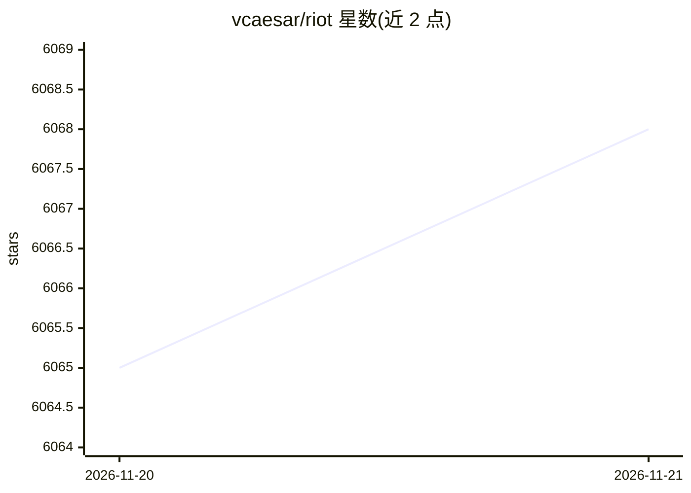

# vcaesar/riot

⭐ 6,068 · Go · Apache-2.0 · 推送 2026-11-20 · [GitHub](https://github.com/vcaesar/riot) · 个人维护 · 中文 README

**Go 语言文本与向量检索引擎库，支持 BM25 与 HNSW**

一个 Go 语言的文本索引与检索库，支持文本、数值、日期、IP、地理点、向量等字段类型，提供词条、短语、模糊、正则、范围、地理查询与 ANN/KNN 向量检索；采用 BM25 评分与可插拔接口，HNSW 近似向量搜索支持 int8 量化及磁盘持久化（内存映射）。内置聚合功能（桶、指标、基数估计、分位数近似）。通过 go get 安装，示例覆盖 CJK 分词（gse）与结构体索引。README 提供与 Bleve、Bluge、Tantivy 的同负载基准数据，声明为单机合成数据结果。

## 筛选速览

| 维度 | 判定 | 备注 |
|---|---|---|
| AI 角色 | `ai-native` | 本体是模型或模型工具 |
| 许可风险 | `permissive` | Apache-2.0 |
| 部署形态 | `None` |  |
| 模型依赖 | — | README 未给出锁定关系 |
| 硬件要求 | — | 无带数字的原话,不猜 |
| 安装摩擦 | `low` | 无编译、无系统依赖或容器化 |
| 成熟度 | — | 结构信号不足 |

## 能力要点

- BM25 评分与可插拔相似度接口
- HNSW 向量搜索支持 int8 量化与磁盘段持久化（内存映射）
- 字段类型覆盖文本/数值/日期/布尔/IP/地理点/向量
- 聚合支持 HyperLogLog++ 基数估计与 T-Digest 分位数近似

## 适用场景

- 在 Go 项目中嵌入全文检索与向量检索
- 对中文/日文等 CJK 文本建索引并高亮搜索结果
- 在磁盘上持久化向量索引并在重启后直接检索

## 场景标签

`向量数据库` `语义搜索` · 领域:知识与检索

## 证据(README 行号)

> L12: A fastest, modern text indexing library in Go.
> L24:  - Geo Bounding Box, Geo Distance, Geo Polygon, ANN, KNN

## 星数曲线

2026-11-20 6,065 → 2026-11-21 6,068（+3）

---
*卡片 v1 · prompt 1.4 · 生成 2026-11-20 · 置信度 mid · 依据 README sha `69b3bb466c15` · [字段定义](../../DATASET.md)*
