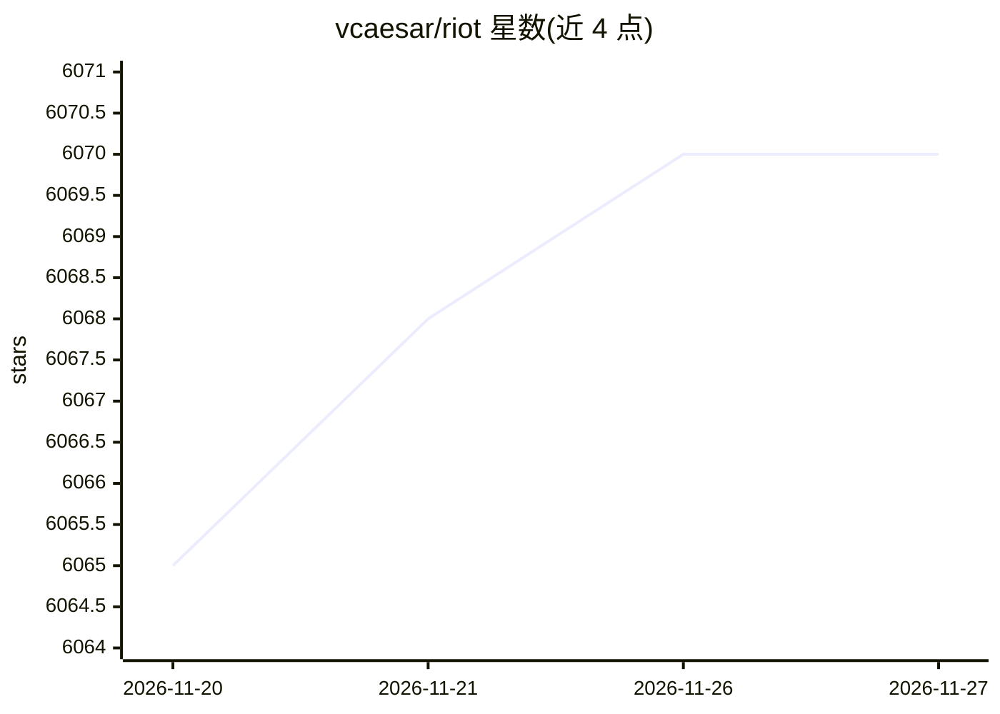

# vcaesar/riot

⭐ 6,070 · Go · Apache-2.0 · 推送 2026-11-24 · [GitHub](https://github.com/vcaesar/riot) · 个人维护 · 中文 README

**Go 语言分布式文本/向量检索引擎库**

以 Go 库形式提供的文本索引与检索引擎，从 Bluge 分叉而来。支持文本/数值/日期/布尔/IP/地理/向量等字段类型，查询涵盖词项、短语、模糊、正则、范围与 ANN/KNN；打分采用 BM25，向量检索使用带 int8 量化的 HNSW 且图数据随段持久化并可内存映射。配合 gse 分词包可处理中日韩文本，另提及基于它构建的分布式引擎 zedsearch。安装方式为 go get，示例程序在仓库内可直接运行。

## 筛选速览

| 维度 | 判定 | 备注 |
|---|---|---|
| AI 角色 | `ai-native` | 本体是模型或模型工具 |
| 许可风险 | `permissive` | Apache-2.0 |
| 部署形态 | `None` |  |
| 模型依赖 | — | README 未给出锁定关系 |
| 硬件要求 | — | 无带数字的原话,不猜 |
| 安装摩擦 | `low` | 无编译、无系统依赖或容器化 |
| 成熟度 | — | 结构信号不足 |

## 能力要点

- 支持向量检索：HNSW ANN 与精确 KNN，int8 量化，索引持久化到磁盘并内存映射
- 查询类型覆盖词项/短语/模糊/正则/通配符及地理与数值范围
- 内置聚合能力：分桶、基数估计（HyperLogLog++）、分位数近似（T-Digest）等
- 通过 gse 分词包支持中文/日文检索与高亮

## 适用场景

- 在 Go 应用中为全文与向量数据搭建检索功能
- 对中日韩文本做索引与带高亮的查询
- 需要将向量索引持久化并在重启后直接检索的场景

## 场景标签

`向量数据库` `语义搜索` · 领域:知识与检索

## 证据(README 行号)

> L12: A fastest, modern text indexing library in Go.
> L24:  - Geo Bounding Box, Geo Distance, Geo Polygon, ANN, KNN
> L26: - HNSW approximate vector search with int8 quantization; graphs persist with segments and are memory-mapped from di

## 星数曲线

2026-11-20 6,065 → 2026-11-27 6,070（+5）

---
*卡片 v1 · prompt 1.4 · 生成 2026-11-22 · 置信度 mid · 依据 README sha `9139e7e0dfbe` · [字段定义](../../DATASET.md)*
