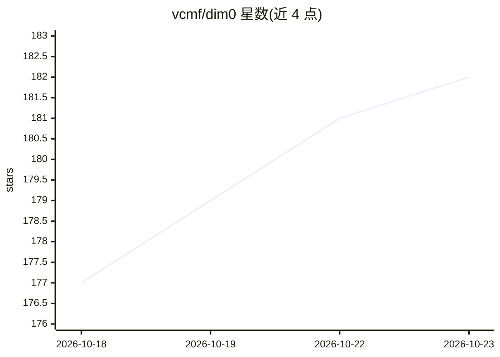

# vcmf/dim0

⭐ 182 · TypeScript · MIT · 推送 2026-10-13 · [GitHub](https://github.com/vcmf/dim0) · [官网](https://dim0.net) · 个人维护

**开源实时协作 AI 画布：笔记、迷你应用与 agent 同板**

基于无限画布的实时协作工作区：支持富文本笔记、代码沙箱、形状/思维导图、嵌套板与演示帧，多人经 WebSocket + 操作变换同步编辑。板感知 agent 基于 OpenAI Agents SDK，可读取画布与选中节点、执行多步工具（笔记、网页、代码、迷你应用生成、Qdrant 记忆），并把结果作为可编辑节点写回画布。自带模型接入（OpenAI/Anthropic/Gemini/DeepSeek/Qwen 等），可生成可交互 React 迷你应用。提供 Docker 自托管、源码运行与三平台桌面端安装脚本。

## 筛选速览

| 维度 | 判定 | 备注 |
|---|---|---|
| AI 角色 | `ai-native` | 本体是模型或模型工具 |
| 许可风险 | `permissive` | MIT |
| 部署形态 | `desktop` | 安装包/桌面程序 |
| 模型依赖 | locked-api |  |
| 硬件要求 | — | 无带数字的原话,不猜 |
| 安装摩擦 | `low` | 无编译、无系统依赖或容器化 |
| 成熟度 | — | 结构信号不足 |

## 能力要点

- 板感知 agent：读取画布、多步工具调用、结果写回为可编辑节点
- 自然语言生成可交互 React 迷你应用（可打开/编辑/导出）
- 实时多人协作：WebSocket + 操作变换，无冲突同步
- 自带模型（OpenAI/Anthropic/Gemini/DeepSeek/Qwen 等），MIT 自托管

## 适用场景

- 在一张无限画布上做笔记、思维导图与文档整理
- 让 agent 根据板上内容生成迷你应用或回答并落回画布
- 团队实时协作编辑同一块画布

## 场景标签

 · 领域:生产力工具/协作画布

## 证据(README 行号)

> L14:  Notes, mini-apps, and an AI agent on one infinite, real-time board. The agent reads what's on the canvas and write
> L25: - 🤖 **Board-aware agent**: reads your canvas and selected nodes, takes multi-step tool actions, and writes results 
> L141: Built on the OpenAI Agents SDK, with board-aware tools wired in:

## 星数曲线

2026-10-18 177 → 2026-10-23 182（+5）

---
*卡片 v1 · prompt 1.4 · 生成 2026-10-22 · 置信度 mid · 依据 README sha `3a477f0c488c` · [字段定义](../../DATASET.md)*
