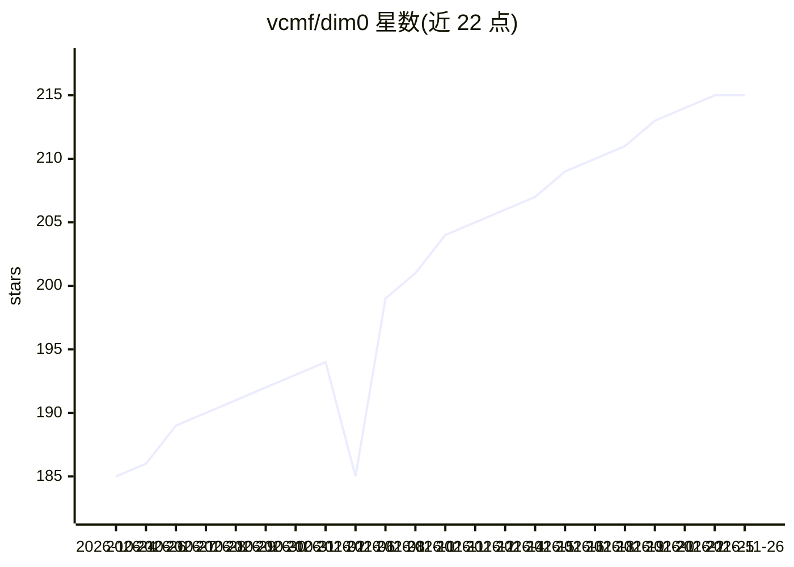

# vcmf/dim0

⭐ 215 · TypeScript · MIT · 推送 2026-11-18 · [GitHub](https://github.com/vcmf/dim0) · [官网](https://dim0.net) · 组织维护

**面向个人与团队的实时协作 AI 无限画布工作台**

将笔记、思维导图、代码沙箱、文档与 AI agent 放在同一无限画布上的协作工作台。agent 读取画布内容与选中节点，经多步工具调用后把结果写回为可编辑节点，也可生成可在画布上打开、编辑、导出 React 代码的 mini-apps。通过 WebSocket 与操作变换实现实时多人同步，内置演示 frames。部署方式为 Docker Compose 拉取官方镜像，另提供 macOS/Linux/Windows 桌面安装包与源码运行路径；agent 与嵌入需配置模型 API key。

## 筛选速览

| 维度 | 判定 | 备注 |
|---|---|---|
| AI 角色 | `ai-native` | 本体是模型或模型工具 |
| 许可风险 | `permissive` | MIT |
| 部署形态 | `desktop` | 安装包/桌面程序 |
| 模型依赖 | locked-api |  |
| 硬件要求 | — | 无带数字的原话,不猜 |
| 安装摩擦 | `low` | 无编译、无系统依赖或容器化 |
| 成熟度 | — | 结构信号不足 |

## 能力要点

- board-aware agent：读取画布与选中节点，多步工具调用，结果写回为可编辑节点
- mini-apps：由描述生成交互式 React 应用，可打开、编辑、导出
- 实时多人协作：live cursors、共享编辑与共享 agent，WebSocket + 操作变换
- 多模型接入：OpenAI、Anthropic、Gemini、Mistral、DeepSeek、Qwen、Moonshot、Z.ai

## 适用场景

- 团队在同一画布上整理笔记、思维导图并共同编辑
- 让 agent 基于画布上的文档做检索问答并把结果留在板面
- 在画布上生成小型交互工具（计算器、图表、可视化）
- 直接从画布 frames 做演示放映

## 场景标签

`知识库管理` `RAG` `AI 助手` · 领域:对话与助手

## 证据(README 行号)

> L13:  Notes, mini-apps, and an AI agent on one infinite, real-time board. The agent reads what's on the canvas and write
> L24: - 🤖 **Board-aware agent**: reads your canvas and selected nodes, takes multi-step tool actions, and writes results 
> L140: Built on the OpenAI Agents SDK, with board-aware tools wired in:

## 星数曲线

2026-10-24 185 → 2026-11-26 215（+30）

---
*卡片 v1 · prompt 1.4 · 生成 2026-11-26 · 置信度 mid · 依据 README sha `aedf158c5e4d` · [字段定义](../../DATASET.md)*
