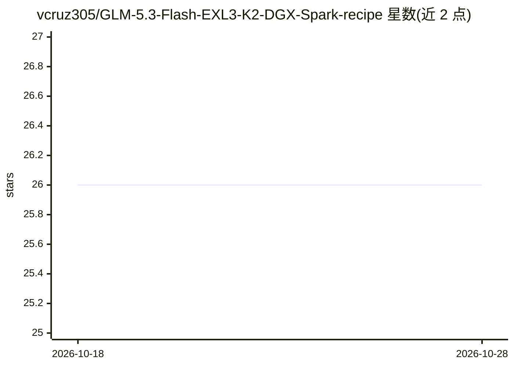

# vcruz305/GLM-5.3-Flash-EXL3-K2-DGX-Spark-recipe

⭐ 26 · Python · NOASSERTION · 推送 2026-09-10 · [GitHub](https://github.com/vcruz305/GLM-5.3-Flash-EXL3-K2-DGX-Spark-recipe) · 个人维护

**在单台 DGX Spark 上用 vLLM fork 部署 GLM-5.3-Flash EXL3 量化模型的运行方案**

面向单台 NVIDIA DGX Spark（GB10/SM121）的模型部署配方仓库：通过 vLLM 兼容 fork、ExLlamaV3 与 vllm-exl3 插件，以 TP=1、原生 MTP k=2、FP8 KV 服务 GLM-5.3-Flash 的 K2/K2K3-mix EXL3 量化权重。提供预构建 wheels 安装脚本、preflight 校验、候选插件测试协议、聊天模板补丁脚本与冒烟测试命令，并保留既有吞吐测量与长上下文证据文档，同时标注基准脚本 schema-1 的已知局限。当前许可为 AGPL-3.0-only，注明为社区独立工作。

## 筛选速览

| 维度 | 判定 | 备注 |
|---|---|---|
| AI 角色 | `ai-ecosystem` | LLM/agent 周边工具 |
| 许可风险 | `none` | NOASSERTION |
| 部署形态 | `None` |  |
| 模型依赖 | local-ok | 支持本地模型 |
| 硬件要求 | — | 无带数字的原话,不猜 |
| 安装摩擦 | `high` | 编译与系统依赖俱全 |
| 成熟度 | `idea` | |

## 能力要点

- TP=1 + 原生 MTP k=2 的单卡 GB10 服务配方
- 提供 preflight 校验、预构建 wheels 与候选插件安装/测试脚本
- 记录候选插件（0.4.2，固定 commit）的待测特性清单与已知局限
- 保留测量证据文档（吞吐、长上下文、精度 KLD、K-pool 缺陷修复）

## 适用场景

- 在 DGX Spark 上本地部署 GLM-5.3-Flash EXL3 量化模型
- 对 vllm-exl3 候选插件做限定协议下的 A/B 性能测试
- 参考既测 tok/s 与长上下文边界证据做容量规划

## 场景标签

`推理引擎` · 领域:训练与推理

## 证据(README 行号)

> L3: Serve **GLM-5.3-Flash EXL3 K2 or K2/K3-mix** on a single GB10 using the compatible vLLM fork, ExLlamaV3 and the cano
> L23: |Prebuilt runtime|spark-vllm wheels, aarch64, Python 3.12, PyTorch 2.13.0+cu130 / CUDA 13|
> L25: |Hardware|One GB10 / SM121, compute capability 12.1; shared CPU/GPU memory must retain OS headroom|

## 星数曲线

2026-10-18 26 → 2026-10-28 26（+0）

---
*卡片 v1 · prompt 1.4 · 生成 2026-10-26 · 置信度 high · 依据 README sha `c15e44350451` · [字段定义](../../DATASET.md)*
