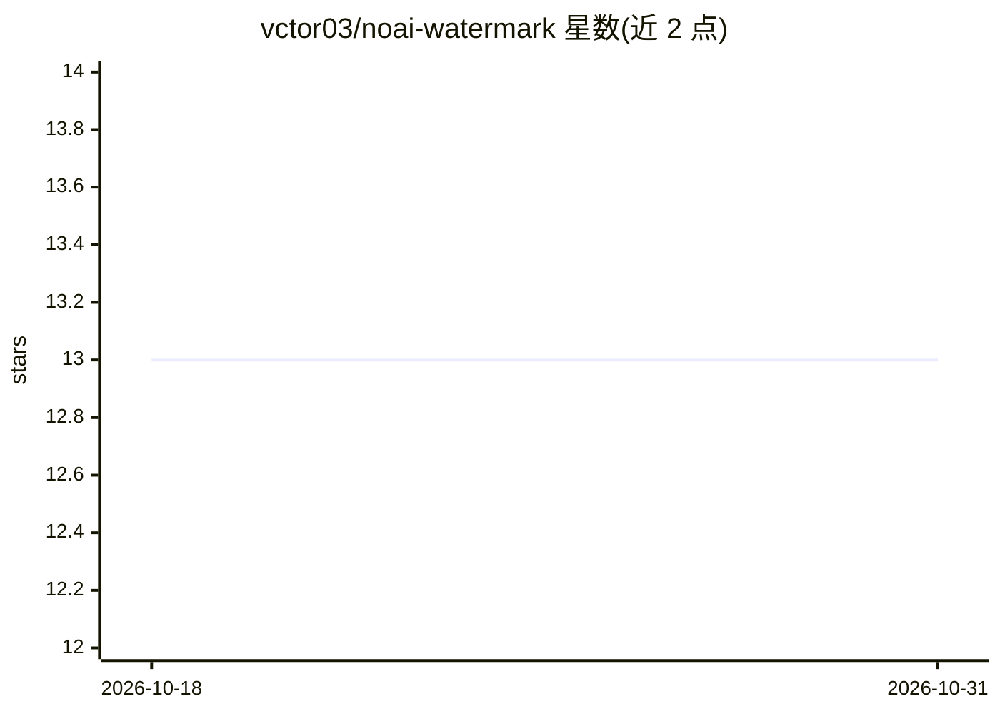

# vctor03/noai-watermark

⭐ 13 · Python · 推送 2026-10-12 · [GitHub](https://github.com/vctor03/noai-watermark) · 个人维护

**移除 AI 生成图片中隐形水印与元数据的 CLI 工具**

面向 Windows 用户的命令行工具，用于清除图片中的隐形 AI 水印（SynthID、StableSignature、TreeRing 等）及 AI 相关元数据，支持 PNG/JPG/TIFF 格式。提供两种使用方式：从 release 页下载 .exe 安装包后使用 CLI，或 pip 安装 Python 包后调用 remove_watermark 函数。宣称处理速度快、对画质影响小，无需管理员权限。要求 Windows 10 及以上、4GB 内存、200MB 磁盘空间。注意：README 中 Python 下载链接指向仓库内 zip 文件而非 python.org。

## 筛选速览

| 维度 | 判定 | 备注 |
|---|---|---|
| AI 角色 | `ai-enhanced` | 去掉 AI 部分产品仍成立 |
| 许可风险 | `none` | — |
| 部署形态 | `desktop` | 安装包/桌面程序 |
| 模型依赖 | — | README 未给出锁定关系 |
| 硬件要求 | — | 无带数字的原话,不猜 |
| 安装摩擦 | `low` | 无编译、无系统依赖或容器化 |
| 成熟度 | — | 结构信号不足 |

## 能力要点

- 针对 SynthID、StableSignature、TreeRing 等隐形水印的移除
- 剥离 AI 相关元数据，支持 PNG/JPG/TIFF
- CLI 与 Python 包两种使用方式（pip install noai-watermark）
- Windows 可执行安装包，无需管理员权限

## 适用场景

- 清除 AI 生成图片中的隐形追踪水印
- 批量剥离图片的 AI 元数据
- 安全研究中验证水印去除对图片的影响

## 场景标签

`图像视频处理` · 领域:感知与多模态

## 证据(README 行号)

> L7: noai-watermark is a free tool that helps you remove hidden AI watermarks and metadata from images. These watermarks 
> L13: - Remove invisible AI watermarks like SynthID, StableSignature, and TreeRing

## 星数曲线

2026-10-18 13 → 2026-10-31 13（+0）

---
*卡片 v1 · prompt 1.4 · 生成 2026-10-31 · 置信度 mid · 依据 README sha `07f469665bda` · [字段定义](../../DATASET.md)*
