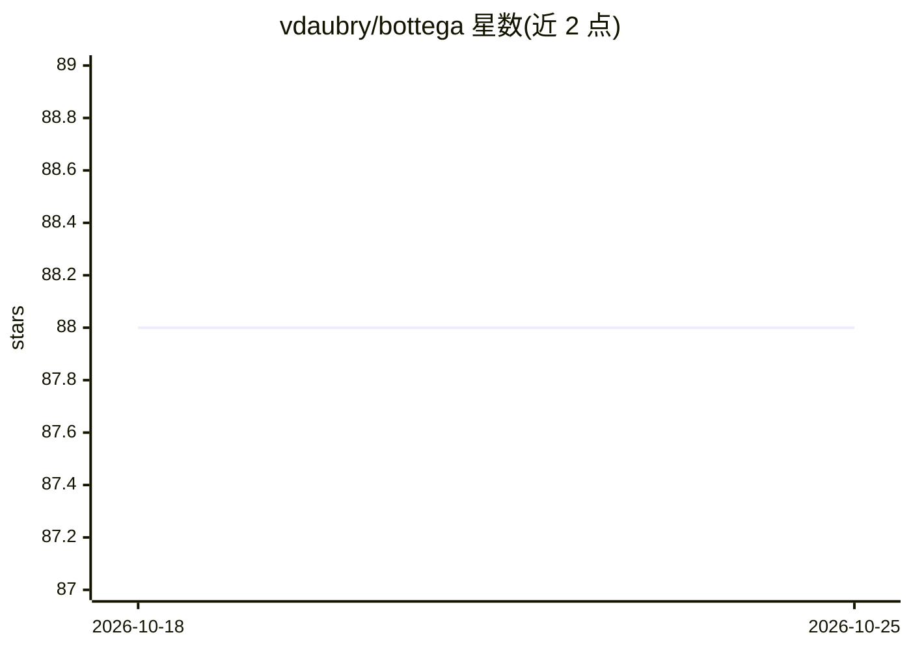

# vdaubry/bottega

⭐ 88 · TypeScript · MIT · 推送 2026-10-05 · [GitHub](https://github.com/vdaubry/bottega) · 个人维护

**面向工程团队的多 agent 编排工具：规格+参考实现**

Bottega 以"AI 三明治"模式编排开发工作流：人定义任务，规划、实现、QA 循环、PR 审查等专职 agent 在中间执行。以 Web UI 运行，支持多用户与远程优先部署。核心交付物是一套规格文档（SPEC.md、core/、extra/），并附带一份 TypeScript/React/Express/SQLite 的完整参考实现，团队可按规格构建自己的版本。支持在同一任务中混用 Claude Code、Codex、OpenCode 三种 agent 运行时（以子进程方式启动其 CLI，OAuth 登录）。参考实现的功能贡献仅接受缺陷修复。

## 筛选速览

| 维度 | 判定 | 备注 |
|---|---|---|
| AI 角色 | `ai-ecosystem` | LLM/agent 周边工具 |
| 许可风险 | `permissive` | MIT |
| 部署形态 | `library` | 以包/库形式分发 |
| 模型依赖 | — | README 未给出锁定关系 |
| 硬件要求 | — | 无带数字的原话,不猜 |
| 安装摩擦 | `low` | 无编译、无系统依赖或容器化 |
| 成熟度 | — | 结构信号不足 |

## 能力要点

- 以规格文档为产品，附带完整可运行的参考实现
- 同一任务可混用 Claude Code / Codex / OpenCode 分配不同角色
- 规划→实现⇄审查循环→PR 的编排引擎，人位于两端
- Epics 层将功能规格经四阶段对话拆解到最终单一 PR

## 适用场景

- 团队在共享服务器上运行多 agent 完成开发任务
- 为不同角色（规划/实现/审查/PR 管理）分配不同模型
- 按规格 fork 并构建符合本团队偏好的定制版本

## 场景标签

`多智能体` `编码 Agent` `代码审查` · 领域:Agent 开发

## 证据(README 行号)

> L3: Bottega is a multi-agent orchestration tool for engineering teams who want an "AI sandwich" approach: Human at the s
> L11: It supports Claude Code, Codex, and OpenCode so you can mix and match models on the same task. For example, use Opu
> L82: **The specification is the product.** This project ships specs so you can build

## 星数曲线

2026-10-18 88 → 2026-10-25 88（+0）

---
*卡片 v1 · prompt 1.4 · 生成 2026-10-23 · 置信度 high · 依据 README sha `7a2a54298587` · [字段定义](../../DATASET.md)*
