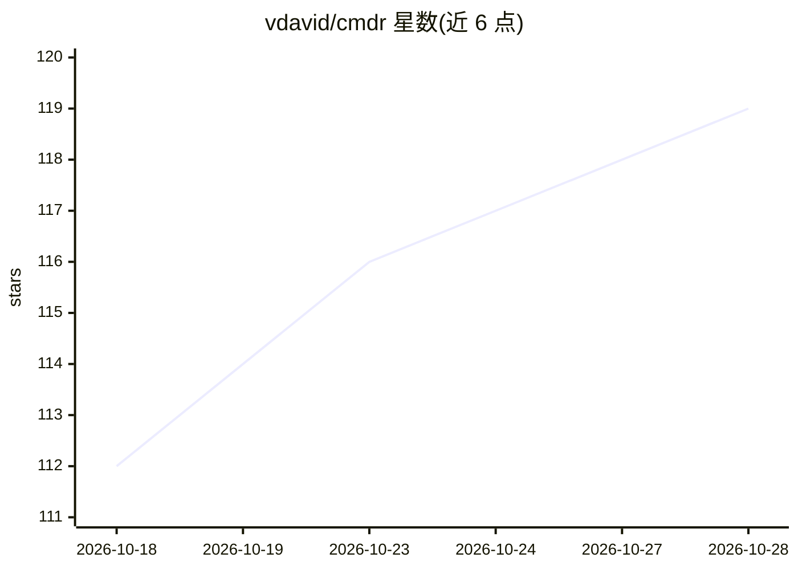

# vdavid/cmdr

⭐ 119 · Rust · NOASSERTION · 推送 2026-10-27 · [GitHub](https://github.com/vdavid/cmdr) · [官网](https://getcmdr.com) · 个人维护

**macOS 键盘驱动的双栏文件管理器，AI 功能可选**

用 Rust+Tauri（后端）与 Svelte+TypeScript（前端）编写的 macOS 双栏文件管理器，面向习惯 Total Commander 键盘操作方式的用户：Tab 切换栏、F5/F6/F7/F8 完成复制/移动/建目录/删除。AI 功能为完全可选项，关闭后即为传统文件管理器体验；开启后提供自然语言搜索与智能选择，本地运行为默认，数据不出本机；自然语言批量重命名（含按图片内容重命名）带人工审核界面。采用 Business Source License 1.1，个人使用免费，商用需购买 59 美元许可证；各版本发布 3 年后转为 AGPL-3.0。仅支持 macOS，Windows/Linux 暂不可用。

## 筛选速览

| 维度 | 判定 | 备注 |
|---|---|---|
| AI 角色 | `ai-enhanced` | 去掉 AI 部分产品仍成立 |
| 许可风险 | `none` | NOASSERTION |
| 部署形态 | `None` |  |
| 模型依赖 | — | README 未给出锁定关系 |
| 硬件要求 | — | 无带数字的原话,不猜 |
| 安装摩擦 | `low` | 无编译、无系统依赖或容器化 |
| 成熟度 | `idea` | |

## 能力要点

- 双栏布局与键盘优先操作（F5/F6/F7/F8 等快捷键）
- 可选 AI 功能：自然语言搜索、智能选择、自然语言批量重命名（含人工审核）
- AI 本地运行默认，文件与数据不离开本机
- 个人使用免费（BSL 1.1），各版本 3 年后转为 AGPL-3.0

## 适用场景

- 在 macOS 上用键盘快捷键完成复制、移动、重命名、删除等文件操作
- 用自然语言搜索与选择文件
- 让 AI 生成批量重命名建议并人工审核后应用

## 场景标签

 · 领域:桌面工具/文件管理

## 证据(README 行号)

> L29: these features gradually. But the intention is that AI features remain fully **optional**. With AI features off, yo
> L31: and (human-approved!) auto-organization coming soon. AI features are local-by-default, so no files or other data le
> L39: - **Optional, privacy-first AI**: search and select with natural language, all on your Mac.

## 星数曲线

2026-10-18 112 → 2026-10-28 119（+7）

---
*卡片 v1 · prompt 1.4 · 生成 2026-10-23 · 置信度 high · 依据 README sha `2282ebd210a7` · [字段定义](../../DATASET.md)*
