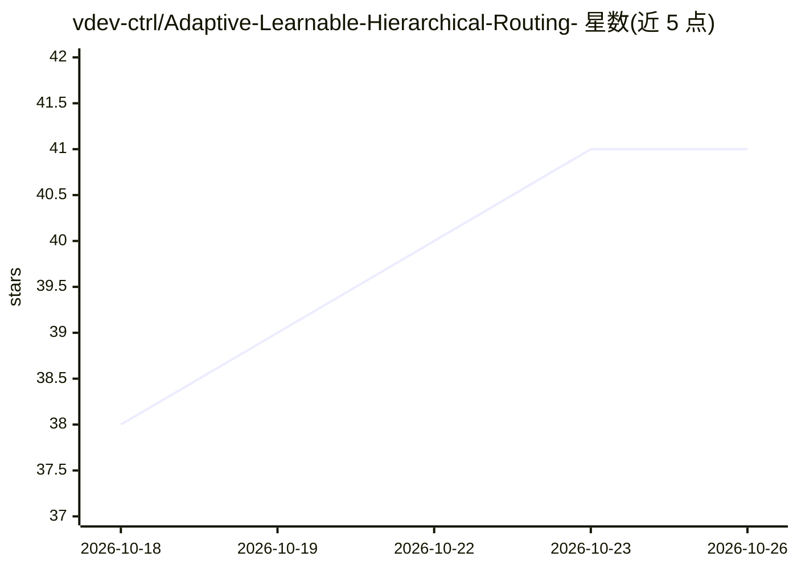

# vdev-ctrl/Adaptive-Learnable-Hierarchical-Routing-

⭐ 41 · Python · Apache-2.0 · 推送 2026-10-11 · [GitHub](https://github.com/vdev-ctrl/Adaptive-Learnable-Hierarchical-Routing-) · 个人维护

**自注意力的树路由替代方案：O(NlogN) 稀疏注意力模块（beta）**

面向 Transformer 研究者的稀疏注意力机制实现：用静态二叉树对 key 矩阵排序，配合可训练的预算预测器为每个 query 决定读取的 key 数量，将推理复杂度降到约 O(NlogN) 并降低 KV 读取量。训练分三阶段：先训练稠密教师模型，再用其注意力矩阵的 top-k 标注训练树模块，最后树与 FFN 联合训练。README 报告 MQAR 基准上接近稠密基线的准确率与更平缓的峰值显存增长；项目标注 beta，论文写作中，代码在 iPhone 与 Kaggle 上完成实验，尚未做内核优化（速度约为稠密的 10 倍耗时）。

## 筛选速览

| 维度 | 判定 | 备注 |
|---|---|---|
| AI 角色 | `ai-native` | 本体是模型或模型工具 |
| 许可风险 | `permissive` | Apache-2.0 |
| 部署形态 | `None` |  |
| 模型依赖 | — | README 未给出锁定关系 |
| 硬件要求 | — | 无带数字的原话,不猜 |
| 安装摩擦 | `low` | 无编译、无系统依赖或容器化 |
| 成熟度 | `idea` | |

## 能力要点

- 静态二叉树 + 可训练预算预测器实现 O(NlogN) 推理
- 三阶段训练：稠密教师蒸馏 top-k，再与 FFN 联合训练
- MQAR 测试：T=4096 时准确率 93.3%（稠密 95.4%），KV 读取压缩约 126 倍
- 峰值显存随 token 增长更平缓（翻倍 token 约 x1.16 vs 稠密 x1.96）

## 适用场景

- 研究者替换标准自注意力以降低长上下文推理开销
- 复现 MQAR 基准上的稀疏注意力实验
- 探索树路由稀疏注意力的训练方法

## 场景标签

 · 领域:深度学习/高效 Transformer

## 证据(README 行号)

> L3: An attention mechanism using static binary trees and learnable functions to achieve sub-quadratic inference without 
> L7: This is a alternative for self-attention that uses O(NlogN) operations instead of O(N^2) operations WITHOUT any sign
> L116: **Note**: If you check the logs, you will see that our tree attention system takes almost 10x the time that dense 

## 星数曲线

2026-10-18 38 → 2026-10-26 41（+3）

---
*卡片 v1 · prompt 1.4 · 生成 2026-10-25 · 置信度 mid · 依据 README sha `cafed3db9245` · [字段定义](../../DATASET.md)*
