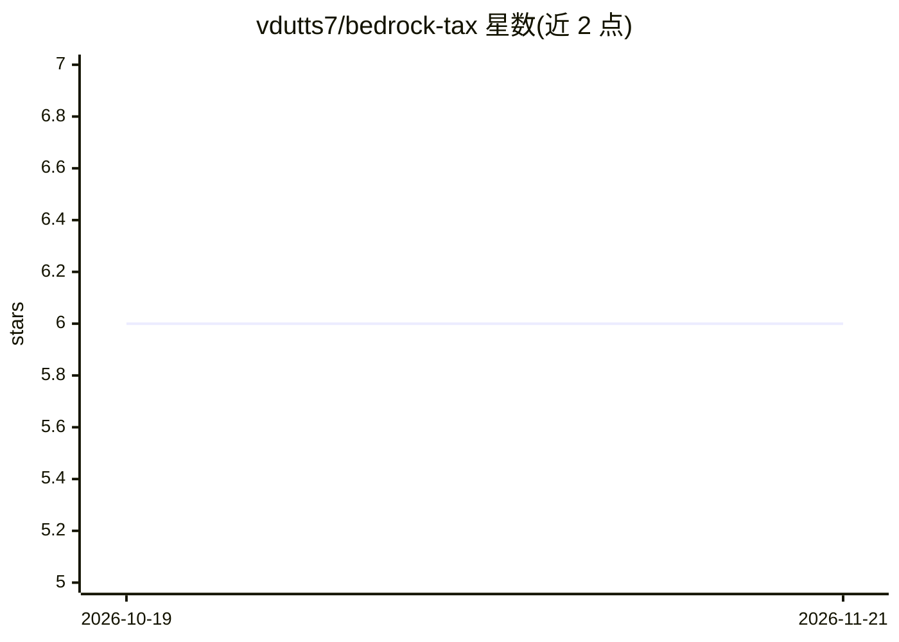

# vdutts7/bedrock-tax

⭐ 6 · Python · 推送 2026-10-08 · [GitHub](https://github.com/vdutts7/bedrock-tax) · 个人维护

**用 Aurora pgvector 替换 OpenSearch 降低 Bedrock 知识库账单的迁移方案**

一篇工程实践记录仓库：作者团队的 oncall triage AI agent 原本通过 AWS Bedrock Knowledge Base（OpenSearch Serverless 后端）做 RAG 检索，因 OpenSearch Serverless 的 2 OCU 最低计费形成每月 $700 固定成本，遂分两步迁移——第一步保留 Bedrock Retrieve API、将向量存储后端换成 Aurora pgvector（成本降至 ~$50/mo），第二步绕过 Bedrock，应用自行用 Titan v2 嵌入并经 RDS Data API 直接 SQL 查询。仓库提供迁移 SQL、完整 schema DDL、分块与索引策略说明及查询模板设计。

## 筛选速览

| 维度 | 判定 | 备注 |
|---|---|---|
| AI 角色 | `ai-knowledge` | 知识聚合/清单类 |
| 许可风险 | `none` | — |
| 部署形态 | `None` |  |
| 模型依赖 | — | README 未给出锁定关系 |
| 硬件要求 | — | 无带数字的原话,不猜 |
| 安装摩擦 | `low` | 无编译、无系统依赖或容器化 |
| 成熟度 | — | 结构信号不足 |

## 能力要点

- 两步迁移路径：换存储后端（保留 Retrieve API）→ 绕过 Bedrock 直接 SQL 查询
- 同表双字段模式：vector(1024) + tsvector GENERATED ALWAYS，支持语义/全文/结构化三种检索
- 使用 ivfflat 余弦距离索引，附 Titan v2 与 Cohere 嵌入模型的成本对比
- agent 采用预建 SQL 模板路由模式而非自由生成 SQL

## 适用场景

- 为 Bedrock Knowledge Base 的高额 OpenSearch Serverless 账单寻找替代后端
- 参考 RAG 系统从托管服务迁移到自管 pgvector 的步骤与 schema 设计
- 设计中小规模（万级以下）向量+全文混合检索表结构

## 场景标签

`RAG` · 领域:知识与检索

## 证据(README 行号)

> L13: ## Problem
> L57: **Migration path**:
> L265: ```

## 星数曲线



2026-10-19 6 → 2026-11-21 6（+0）


---
*卡片 v1 · prompt 1.4 · 生成 2026-11-20 · 置信度 mid · 依据 README sha `6b7e9f992b99` · [字段定义](../../DATASET.md)*
