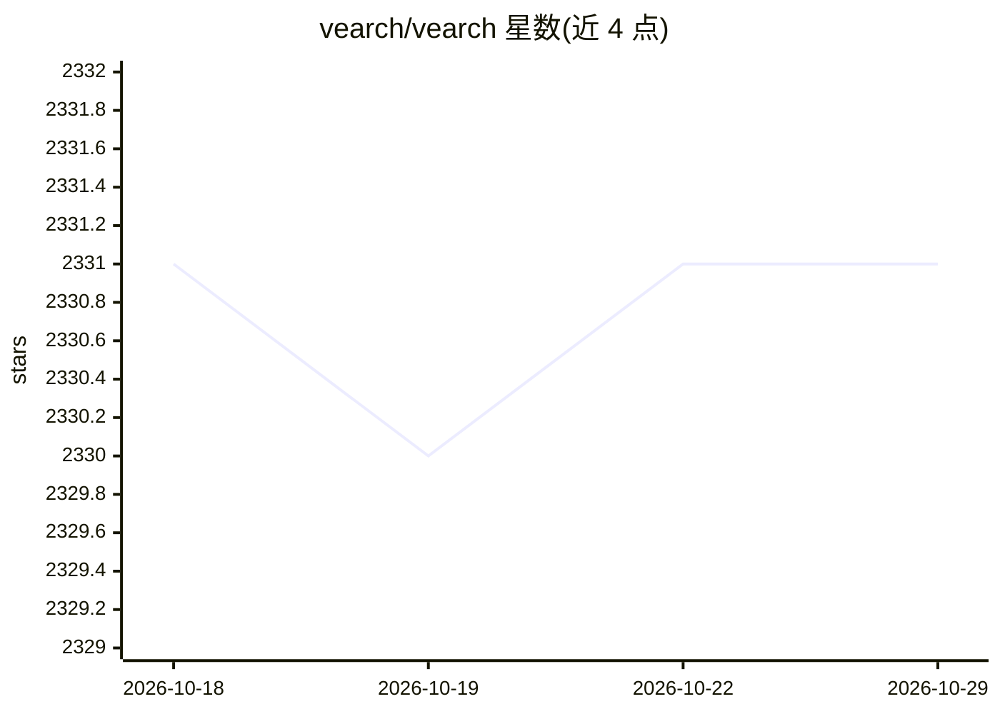

# vearch/vearch

⭐ 2,331 · Python · Apache-2.0 · 推送 2026-07-27 · [GitHub](https://github.com/vearch/vearch) · [官网](https://vearch.github.io) · 组织维护 · 中文 README

**面向 AI 应用的云原生分布式向量数据库，支持混合检索**

Vearch 是用于 embedding 向量相似度检索的分布式向量数据库，支持向量搜索与标量过滤的混合检索，提供复制与弹性扩展。架构由 Master（元数据管理）、Router（RESTful API 与请求路由）、PartitionServer（基于 raft 复制、内嵌 faiss 实现的 Gamma 引擎）组成。提供 Python/Go/Java/Rust SDK，并可与 LangChain、LlamaIndex 等框架集成作为向量存储。部署方式包括 Kubernetes Helm、Docker Compose 与源码编译。

## 筛选速览

| 维度 | 判定 | 备注 |
|---|---|---|
| AI 角色 | `ai-ecosystem` | LLM/agent 周边工具 |
| 许可风险 | `permissive` | Apache-2.0 |
| 部署形态 | `self-host` | docker 或自建部署 |
| 模型依赖 | — | README 未给出锁定关系 |
| 硬件要求 | — | 无带数字的原话,不猜 |
| 安装摩擦 | `low` | 无编译、无系统依赖或容器化 |
| 成熟度 | — | 结构信号不足 |

## 能力要点

- 向量搜索与标量过滤的混合检索
- Master/Router/PartitionServer 三组件分布式架构，Gamma 引擎基于 faiss
- Python/Go/Java/Rust 四种语言 SDK
- 与 LangChain/LlamaIndex/LangChain4j 集成作为向量存储

## 适用场景

- 为 RAG 应用提供向量存储与检索后端
- 构建索引海量图片的视觉检索系统
- 需要弹性扩展与复制的生产级向量检索服务

## 场景标签

`向量数据库` · 领域:知识与检索

## 证据(README 行号)

> L10: Vearch is a cloud-native distributed vector database for efficient similarity search of embedding vectors in your A
> L47: |**Langchain**|Use Vearch as vector store in Langchain|

## 星数曲线

2026-10-18 2,331 → 2026-10-29 2,331（+0）

---
*卡片 v1 · prompt 1.4 · 生成 2026-10-21 · 置信度 high · 依据 README sha `1439c892063c` · [字段定义](../../DATASET.md)*
