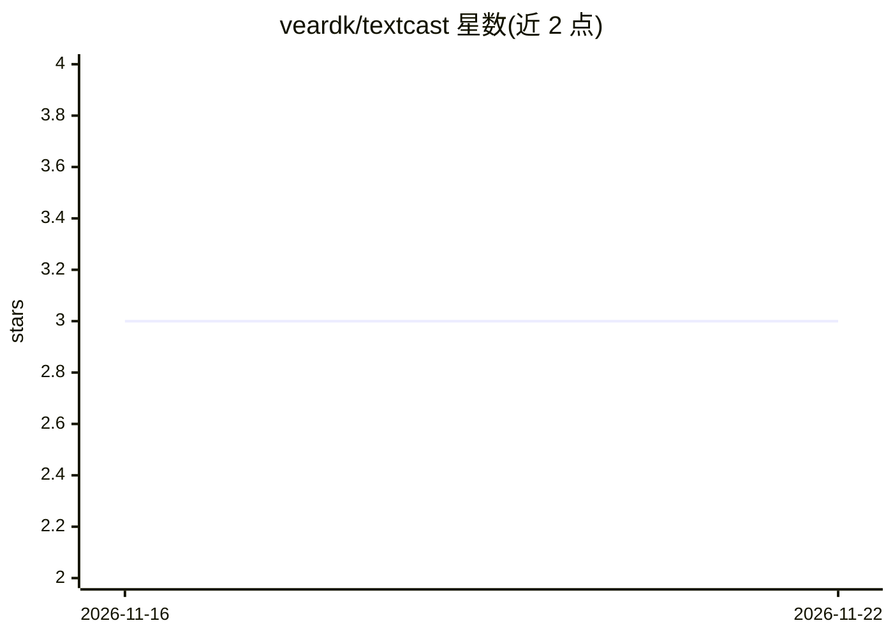

# veardk/textcast

⭐ 3 · Python · MIT · 推送 2026-11-17 · [GitHub](https://github.com/veardk/textcast) · 个人维护 · 中文 README

**把播客/视频转为可阅读的双语字幕页，支持边读边与 agent 对话**

Textcast 是一个 Agent Skill：由用户已有的 agent（Claude Code/Codex/Gemini CLI 等）抓取 YouTube 或 Bilibili 的字幕，逐行翻译并按主题分组，生成单文件 HTML 阅读页输出到 ./textcast/output/。页面带侧边对话面板，选中任意句子可向 agent 提问或要求修改；点击任意行可在浮动播放器中从该时刻播放。脚本部分负责字幕抓取、时间戳校验（时间均来自字幕、不猜测）。限制：本地音视频转录尚不支持，需自备字幕文件；Bilibili 抓取需登录会话。

## 筛选速览

| 维度 | 判定 | 备注 |
|---|---|---|
| AI 角色 | `ai-ecosystem` | LLM/agent 周边工具 |
| 许可风险 | `permissive` | MIT |
| 部署形态 | `library` | 以包/库形式分发 |
| 模型依赖 | locked-api |  |
| 硬件要求 | — | 无带数字的原话,不猜 |
| 安装摩擦 | `low` | 无编译、无系统依赖或容器化 |
| 成熟度 | — | 结构信号不足 |

## 能力要点

- 逐行完整转录与翻译，不做摘要省略
- 阅读页内置 agent 对话面板，选中句子即可提问并就地更新页面
- 点击任意行从对应时间点浮动播放视频
- 也支持 .srt/.vtt/.json 字幕、Markdown、PDF 与网页文本

## 适用场景

- 把长播客转成带主题索引的文本阅读
- 对照原文与译文学外语播客内容
- 给 agent 技能库添加视频转阅读能力

## 场景标签

`文档解析` · 领域:知识与检索

## 证据(README 行号)

> L21: Long articles and documents work too. Textcast is an Agent Skill: your agent does the reading and translating itsel
> L23: ## Install
> L33: `-g` installs it for your user, so it works in every folder. Add `-a <agent>` to choose the agent up front (`claude

## 星数曲线

2026-11-16 3 → 2026-11-22 3（+0）

---
*卡片 v1 · prompt 1.4 · 生成 2026-11-21 · 置信度 high · 依据 README sha `3b026d0baa34` · [字段定义](../../DATASET.md)*
