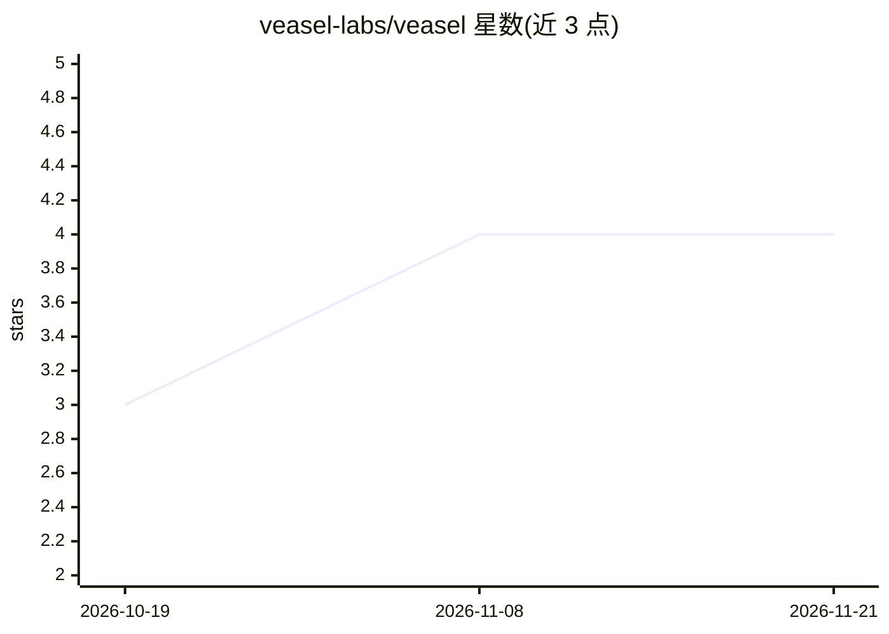

# veasel-labs/veasel

⭐ 4 · TypeScript · MIT · 推送 2026-11-20 · [GitHub](https://github.com/veasel-labs/veasel) · [官网](https://www.veasel.dev) · 组织维护

**V 语言编写的开源终端 AI 编码代理，本地运行、审批生效**

Veasel Code 是一个用 V 实现的开源 AI 编码代理，包含回环 HTTP 后端与 OpenTUI 终端客户端。仓库保持本地；文件编辑、shell 执行与 MCP 调用均生成提案，需用户显式审批后方可生效。提供 OpenAI 兼容、Anthropic、Gemini、Meta Responses 适配器与流式输出，API key 存入 OS keychain，shell 默认在 fail-closed 沙箱（Bubblewrap/Seatbelt/AppContainer）中运行。安装通过 GitHub Releases 预发布归档，或源码用 V 与 Bun 运行。

## 筛选速览

| 维度 | 判定 | 备注 |
|---|---|---|
| AI 角色 | `ai-native` | 本体是模型或模型工具 |
| 许可风险 | `permissive` | MIT |
| 部署形态 | `None` |  |
| 模型依赖 | locked-api |  |
| 硬件要求 | — | 无带数字的原话,不猜 |
| 安装摩擦 | `low` | 无编译、无系统依赖或容器化 |
| 成熟度 | — | 结构信号不足 |

## 能力要点

- 编辑/shell/MCP 提案需显式审批，工作历史可分页检索（/runs）
- 默认 fail-closed 沙箱：Bubblewrap/Seatbelt/AppContainer，缺失后端拒绝执行
- OS keychain 存密钥（secret-tool/Keychain/Credential Manager），不可用时拒绝明文写入
- Skill 与 MCP 服务器发现，支持 stdio/HTTP MCP 及多代理技能目录导入

## 适用场景

- 在终端与本地仓库对话完成编码任务，逐条审批文件修改与命令
- 通过回环 HTTP API 与 SSE 事件流把代理集成到自有客户端
- 复用其他代理工具（Claude/Codex/Cursor 等）目录下的 SKILL.md 技能

## 场景标签

`编码 Agent` · 领域:编码与开发

## 证据(README 行号)

> L14: **Veasel Code** is an open-source AI coding agent with a **V-native runtime**,
> L103: - OpenAI-compatible, Meta Responses, Anthropic, and Gemini adapters with
> L116: Honesty bounds that stay in the product voice:

## 星数曲线

2026-10-19 3 → 2026-11-21 4（+1）

---
*卡片 v1 · prompt 1.4 · 生成 2026-11-21 · 置信度 high · 依据 README sha `c50a4ed9c089` · [字段定义](../../DATASET.md)*
