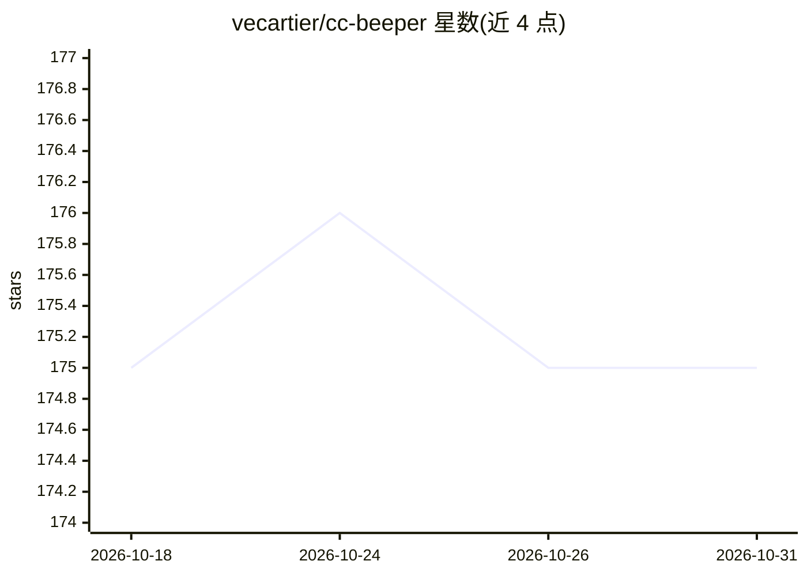

# vecartier/cc-beeper

⭐ 175 · Swift · NOASSERTION · 推送 2026-04-12 · [GitHub](https://github.com/vecartier/cc-beeper) · 个人维护

**macOS 桌面挂件：实时查看 Claude Code 状态并语音应答权限请求**

用 Swift/SwiftUI 编写的 macOS 浮动桌面挂件，通过本地 HTTP 服务器与注册在 ~/.claude/settings.json 的 7 个 hook 脚本跟踪 Claude Code 会话，显示 8 种状态（含权限请求、提问、错误），支持远程批准/拒绝权限，提供 Strict/Relaxed/Trusted/YOLO 四档自动接受模式。语音功能含 WhisperKit/Apple Speech 离线听写与 Kokoro TTS 朗读，全部本地运行、无外发连接。要求 macOS 14+ 与 Claude Code CLI，通过 DMG 安装。

## 筛选速览

| 维度 | 判定 | 备注 |
|---|---|---|
| AI 角色 | `ai-ecosystem` | LLM/agent 周边工具 |
| 许可风险 | `none` | NOASSERTION |
| 部署形态 | `desktop` | 安装包/桌面程序 |
| 模型依赖 | — | README 未给出锁定关系 |
| 硬件要求 | — | 无带数字的原话,不猜 |
| 安装摩擦 | `low` | 无编译、无系统依赖或容器化 |
| 成熟度 | — | 结构信号不足 |

## 能力要点

- 跟踪 Claude Code 8 种状态并支持 ⌥A/⌥D 远程批准或拒绝权限
- WhisperKit/Apple Speech 本地听写（99 种语言）与 Kokoro 本地朗读（54 声音）
- 4 档自动接受模式，可随时在菜单栏切换
- 全部本地通信（127.0.0.1），无遥测与外发连接

## 适用场景

- 终端被遮挡时不错过 Claude Code 的完成、报错或权限请求
- 用语音口述提示词或回答 Claude 的提问，双手不离键盘工作流
- 多会话并行时在一个挂件上掌握所有 Claude Code 实例状态

## 场景标签

 · 领域:开发者工具/桌面应用

## 证据(README 行号)

> L116: CC-Beeper binds to a local port (19222-19230) on launch and registers 7 hook scripts in `~/.claude/settings.json`:
> L94: **Requirements:** macOS 14 Sonoma+ · Claude Code CLI

## 星数曲线

2026-10-18 175 → 2026-10-31 175（+0）

---
*卡片 v1 · prompt 1.4 · 生成 2026-10-22 · 置信度 high · 依据 README sha `b1827b6b5689` · [字段定义](../../DATASET.md)*
