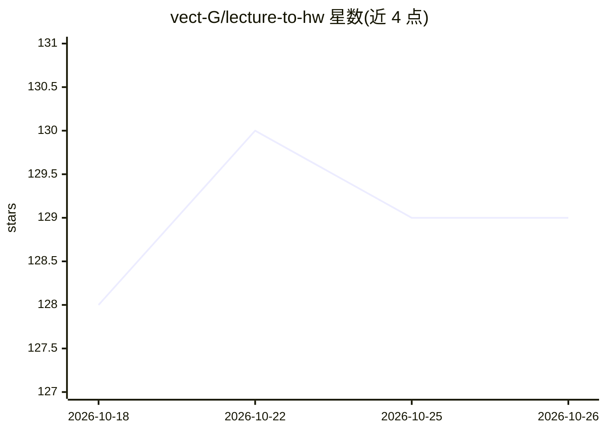

# vect-G/lecture-to-hw

⭐ 129 · MIT · 推送 2026-05-08 · [GitHub](https://github.com/vect-G/lecture-to-hw) · 个人维护 · 中文 README

**把课件与作业题自动转成 Markdown 作业答案的 Codex skill**

面向大学生的 OpenAI Codex 技能（SKILL.md 形式）：在课程目录中自动定位题面（PDF/DOCX/Markdown/HTML/图片/notebook）、课件与历史作业，按主 agent 调度、最多 4 个并行子代理的流水线完成解题、代码复现与 Markdown 组装，另有助教 review agent 检查漏题、公式与 AI 味。可读取历史作业学习格式习惯，交付时报告生成文件、验证情况与可信度（高/中/低）。安装方式为 git clone 到 ~/.codex/skills 目录，由 Codex 会话自动发现。

## 筛选速览

| 维度 | 判定 | 备注 |
|---|---|---|
| AI 角色 | `ai-native` | 本体是模型或模型工具 |
| 许可风险 | `permissive` | MIT |
| 部署形态 | `None` |  |
| 模型依赖 | — | README 未给出锁定关系 |
| 硬件要求 | — | 无带数字的原话,不猜 |
| 安装摩擦 | `low` | 无编译、无系统依赖或容器化 |
| 成熟度 | — | 结构信号不足 |

## 能力要点

- 从课件、课堂代码与历史作业中定位方法并复现实验结果
- 多 agent 并行流水线（默认最多 4 个子代理）+ 助教 review agent
- 支持 PDF/DOCX/Markdown/HTML/notebook/图片/压缩包等多种题面格式
- 读取历史作业学习格式习惯，交付时给出可信度评级与复核建议

## 适用场景

- 我想把整套课程作业流程交给 agent，最终拿到可提交的 Markdown 文档
- 希望答案使用课件里讲过的方法和记号，接近自己的历史作业风格
- 作业完成后让助教 agent 检查漏题和明显错误再提交

## 场景标签

 · 领域:教育/作业自动化

## 证据(README 行号)

> L4:  Codex Skill
> L10:  从课程课件到可交付 Markdown 作业的一站式 Codex skill。
> L41: 读题 -> 找课件 -> 找课堂中讲授的方法 -> 拆解题目 -> 解题/跑代码 -> 组装 Markdown -> 助教agent执行review -> 交付

## 星数曲线

2026-10-18 128 → 2026-10-26 129（+1）

---
*卡片 v1 · prompt 1.4 · 生成 2026-10-22 · 置信度 high · 依据 README sha `510cf8e1c1de` · [字段定义](../../DATASET.md)*
