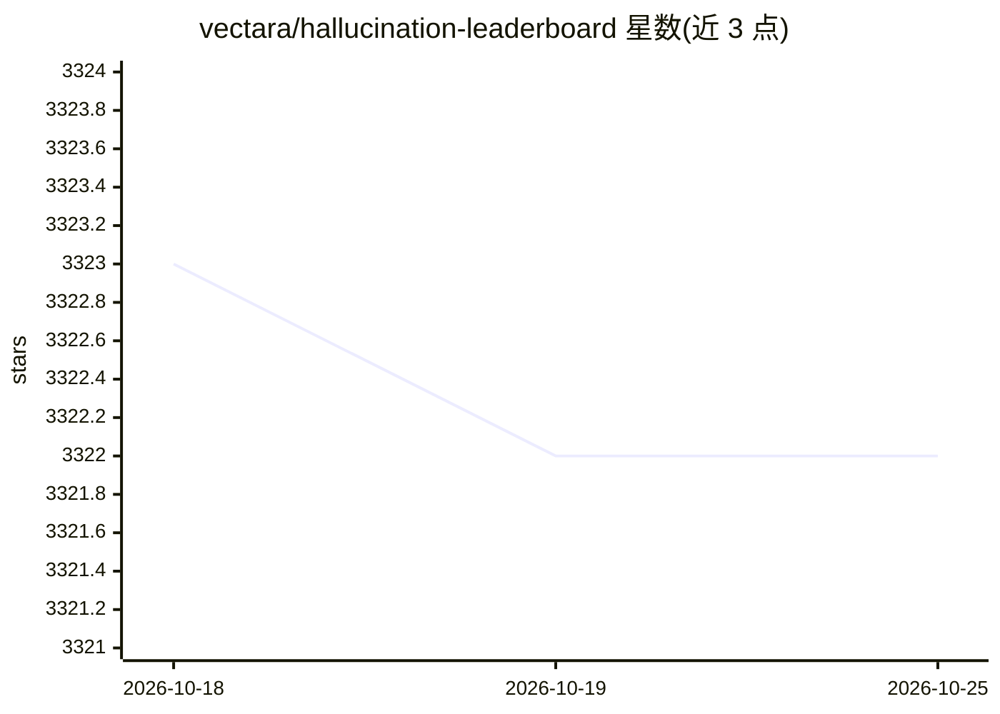

# vectara/hallucination-leaderboard

⭐ 3,323 · Python · Apache-2.0 · 推送 2026-10-23 · [GitHub](https://github.com/vectara/hallucination-leaderboard) · [官网](https://vectara.com) · 组织维护

**公开 LLM 幻觉率排行榜：基于 HHEM 评测摘要忠实度**

Vectara 维护的公开 LLM 幻觉率排行榜：将 7700+ 篇多领域文章喂给各 LLM 做仅基于原文的摘要，再用其商用评测模型 HHEM-2.3 计算幻觉率与事实一致性率，同时统计拒答率与平均摘要长度。评测数据集不公开以避免模型过拟合，调用时温度设为 0。README 以静态表格形式列出百余个模型的排名，另在 Hugging Face 提供交互版，并附方法论、提示词与各 API 接入细节。

## 筛选速览

| 维度 | 判定 | 备注 |
|---|---|---|
| AI 角色 | `ai-knowledge` | 知识聚合/清单类 |
| 许可风险 | `permissive` | Apache-2.0 |
| 部署形态 | `None` |  |
| 模型依赖 | locked-api |  |
| 硬件要求 | — | 无带数字的原话,不猜 |
| 安装摩擦 | `low` | 无编译、无系统依赖或容器化 |
| 成熟度 | — | 结构信号不足 |

## 能力要点

- 基于 Vectara HHEM-2.3 幻觉评测模型计算排名
- 7700+ 篇不公开文章，覆盖新闻/科技/医学/法律等领域，长度 50 至 24K 词
- 指标含幻觉率、事实一致性率、拒答率与平均摘要长度
- Hugging Face 提供交互版排行榜，开源版模型 HHEM-2.1-Open 可在 HF/Kaggle 获取

## 适用场景

- 选型时对比各 LLM 在摘要任务上的幻觉率
- 评估 LLM 用于 RAG 或 Agentic 摘要场景的可靠性参考
- 追踪新模型发布后的幻觉表现变化

## 场景标签

`模型评测` · 领域:评测与运维

## 证据(README 行号)

> L3: Public LLM leaderboard computed using Vectara's Hallucination Evaluation Model, also known as HHEM. This evaluates h
> L130: This leaderboard uses HHEM-2.3, Vectara's commercial hallucination evaluation model, to compute the LLM rankings. 
> L157: To build this leaderboard, fed the full set of documents in the dataset to each of the LLMs and asked them to summ

## 星数曲线

2026-10-18 3,323 → 2026-10-25 3,322（-1）

---
*卡片 v1 · prompt 1.4 · 生成 2026-10-20 · 置信度 high · 依据 README sha `7c86fe428d6e` · [字段定义](../../DATASET.md)*
