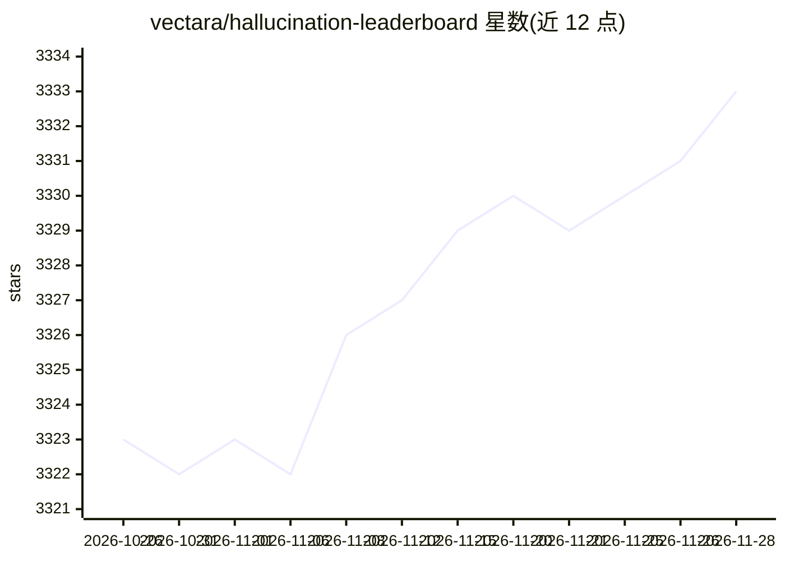

# vectara/hallucination-leaderboard

⭐ 3,333 · Python · Apache-2.0 · 推送 2026-11-24 · [GitHub](https://github.com/vectara/hallucination-leaderboard) · [官网](https://vectara.com) · 组织维护

**LLM 摘要幻觉率排行榜：为选型者量化各模型摘要可信度**

使用 Vectara 的 HHEM 评估模型计算各 LLM 在短文档摘要任务中引入幻觉的频率，输出幻觉率、事实一致性率、应答率与平均摘要长度四项指标，按幻觉率排序并定期更新。评估数据集为不公开的 7700+ 篇多领域文章（50 词至 24K 词），采用 temperature=0 调用各模型 API，README 给出所用提示词与方法论说明。当前版本基于 HHEM-2.3 商业评估模型，另提供开源变体 HHEM-2.1-Open，并在 Hugging Face 提供交互式榜单。

## 筛选速览

| 维度 | 判定 | 备注 |
|---|---|---|
| AI 角色 | `ai-knowledge` | 知识聚合/清单类 |
| 许可风险 | `permissive` | Apache-2.0 |
| 部署形态 | `None` |  |
| 模型依赖 | locked-api |  |
| 硬件要求 | — | 无带数字的原话,不猜 |
| 安装摩擦 | `low` | 无编译、无系统依赖或容器化 |
| 成熟度 | — | 结构信号不足 |

## 能力要点

- 按幻觉率排序的 LLM 排行榜，含幻觉率、事实一致性率、应答率、平均摘要长度四项指标
- 评估基于 7700+ 篇不公开的多领域文章数据集，覆盖 50 词至 24K 词
- 当前版本使用 HHEM-2.3 商业评估模型，另有开源变体 HHEM-2.1-Open
- 提供评估方法论文档与所用提示词全文

## 适用场景

- 在 RAG/Agent 流水线选型摘要模型时查看各模型的幻觉率表现
- 跟踪不同 LLM 版本更新后摘要事实一致性的变化
- 研究摘要事实一致性评估方法时参考相关论文与方法论

## 场景标签

`模型评测` · 领域:评测与运维

## 证据(README 行号)

> L1: # Hallucination Leaderboard
> L3: Public LLM leaderboard computed using Vectara's Hallucination Evaluation Model, also known as HHEM. This evaluates h
> L165: To build this leaderboard, fed the full set of documents in the dataset to each of the LLMs and asked them to summ

## 星数曲线

2026-10-26 3,323 → 2026-11-28 3,333（+10）

---
*卡片 v1 · prompt 1.4 · 生成 2026-11-26 · 置信度 high · 依据 README sha `46d895061235` · [字段定义](../../DATASET.md)*
