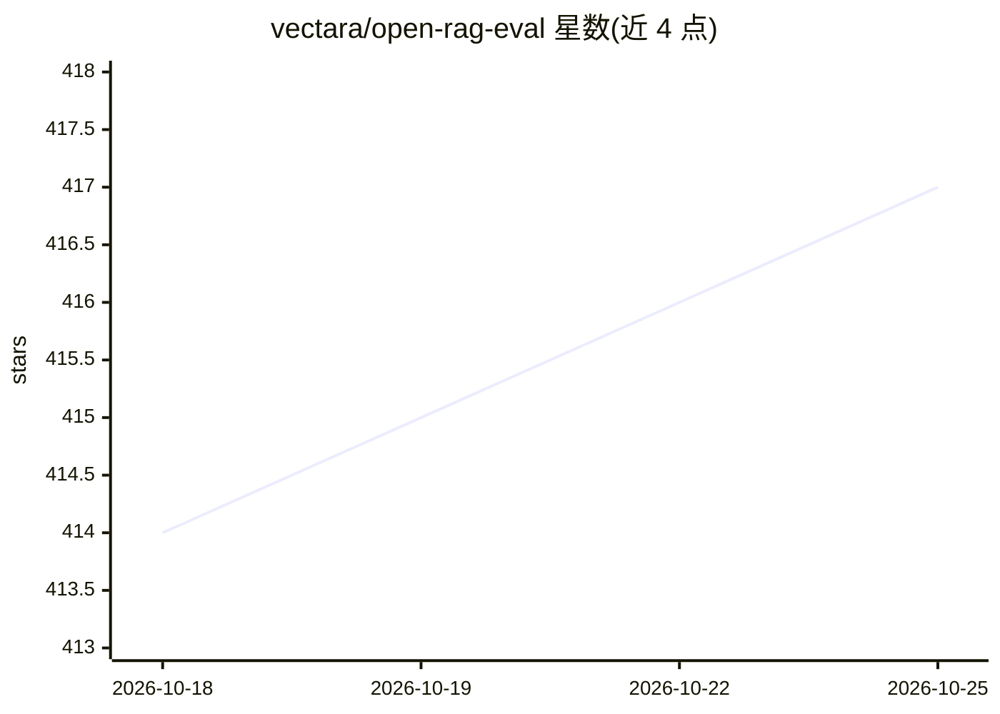

# vectara/open-rag-eval

⭐ 417 · Python · Apache-2.0 · 推送 2026-10-08 · [GitHub](https://github.com/vectara/open-rag-eval) · [官网](https://github.com/vectara/open-rag-eval) · 组织维护

**开源 RAG 评测工具包：无需标准答案评估 RAG 质量**

Vectara 开源的 Python RAG 评测工具包，核心指标 UMBRELA 与 AutoNuggetizer 无需 golden chunks 或 golden 答案，另支持可选的标准答案评测。内置 TREC-RAG 基准指标实现，提供 Vectara 平台连接器及 LlamaIndex、LangChain 连接器，也可评测自有 RAG 输出（CSV 格式）。事实一致性评估默认用开源 HHEM 幻觉检测模型（需 HF token），可选 Vectara 商业 API。附 CLI 运行评测与绘图，支持 Web/CLI/Streamlit 三种可视化，并可用 LLM 从语料生成合成查询。运行需 Python 3.9+，部分指标需 OpenAI API key。

## 筛选速览

| 维度 | 判定 | 备注 |
|---|---|---|
| AI 角色 | `ai-ecosystem` | LLM/agent 周边工具 |
| 许可风险 | `permissive` | Apache-2.0 |
| 部署形态 | `library` | 以包/库形式分发 |
| 模型依赖 | — | README 未给出锁定关系 |
| 硬件要求 | — | 无带数字的原话,不猜 |
| 安装摩擦 | `low` | 无编译、无系统依赖或容器化 |
| 成熟度 | — | 结构信号不足 |

## 能力要点

- UMBRELA 与 AutoNuggetizer 核心指标无需 golden 答案
- 内置 TREC-RAG 基准评测指标实现
- Vectara 连接器开箱即用，另支持 LlamaIndex/LangChain 与自有 RAG 输出
- HHEM 幻觉检测（默认）或 Vectara API 两种事实一致性评估路径
- LLM 自动生成合成评测查询

## 适用场景

- 评估自己 RAG 系统的回答质量并定位改进点
- 无标注数据时用 UMBRELA/AutoNuggetizer 做可扩展评测
- 对比不同 RAG 配置或多次运行的指标结果
- 检测 RAG 回答中的幻觉（事实一致性打分）

## 场景标签

`模型评测` · 领域:评测与运维

## 证据(README 行号)

> L12: **Evaluate and improve your Retrieval-Augmented Generation (RAG) pipelines with `open-rag-eval`, an open-source Pyt
> L16: The core metrics (UMBRELA, AutoNuggetizer) do not require golden chunks or golden answers, making RAG evaluation ea

## 星数曲线

2026-10-18 414 → 2026-10-25 417（+3）

---
*卡片 v1 · prompt 1.4 · 生成 2026-10-21 · 置信度 high · 依据 README sha `f5174253ddfd` · [字段定义](../../DATASET.md)*
