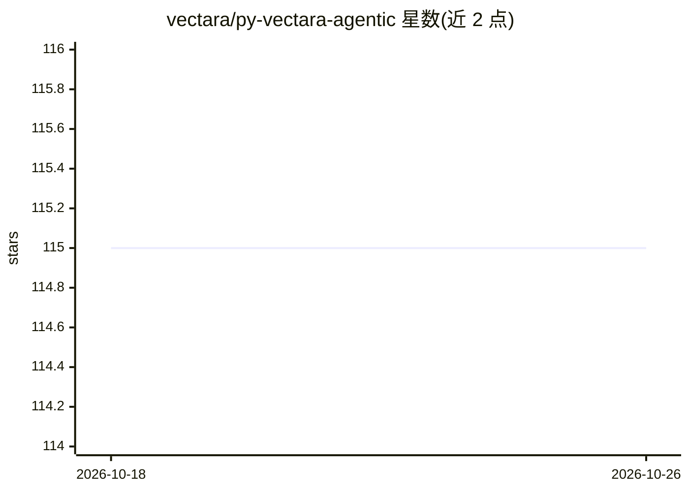

# vectara/py-vectara-agentic

⭐ 115 · Python · Apache-2.0 · 推送 2025-11-10 · [GitHub](https://github.com/vectara/py-vectara-agentic) · [官网](https://vectara.com) · 组织维护

**基于 Vectara 与 Agentic RAG 构建 AI 助手的 Python 库**

面向开发者的 Python 库，用于开发连接 Vectara 平台的 AI 助手与 agent。基于 LlamaIndex Agent 框架，提供 create_rag_tool/create_search_tool 等辅助函数一行代码创建连接 Vectara 语料库的工具，支持 ReAct 与 Function Calling 两类 agent。内置金融、法律、数据库等领域的预置工具，可集成 LlamaIndex ToolSpecs 生态工具。限制：需 Vectara 账号、语料库与 API key，Python 3.10+，另需一个 LLM 提供商的 API key（OpenAI/Anthropic/Gemini/GROQ/Together.AI/Cohere/Bedrock）。

## 筛选速览

| 维度 | 判定 | 备注 |
|---|---|---|
| AI 角色 | `ai-ecosystem` | LLM/agent 周边工具 |
| 许可风险 | `permissive` | Apache-2.0 |
| 部署形态 | `library` | 以包/库形式分发 |
| 模型依赖 | — | README 未给出锁定关系 |
| 硬件要求 | — | 无带数字的原话,不猜 |
| 安装摩擦 | `low` | 无编译、无系统依赖或容器化 |
| 成熟度 | — | 结构信号不足 |

## 能力要点

- 一行代码创建 Vectara RAG 工具与搜索工具，支持元数据过滤与 fixed_filter
- 支持 ReAct 与 Function Calling 两类 agent，提供同步/异步/流式对话接口
- 内置金融（Yahoo! Finance）、法律、数据库查询等预置领域工具
- 通过 ToolsFactory 接入 LlamaIndex ToolSpecs 生态工具（Tavily/EXA.AI/Brave 等）

## 适用场景

- 在 Vectara 语料库之上构建领域问答助手（金融/法律/教学）
- 为 agent 组合 RAG 查询、数据库访问与网络搜索工具
- 构建带元数据过滤的 Agentic RAG 应用

## 场景标签

`Agent 框架` `RAG` · 领域:Agent 开发

## 证据(README 行号)

> L29: `vectara-agentic` is a Python library for developing powerful AI assistants and agents using Vectara and Agentic-RA
> L193: `vectara-agentic` provides two helper functions to connect with Vectara RAG:

## 星数曲线

2026-10-18 115 → 2026-10-26 115（+0）

---
*卡片 v1 · prompt 1.4 · 生成 2026-10-23 · 置信度 high · 依据 README sha `f95aa89afb28` · [字段定义](../../DATASET.md)*
