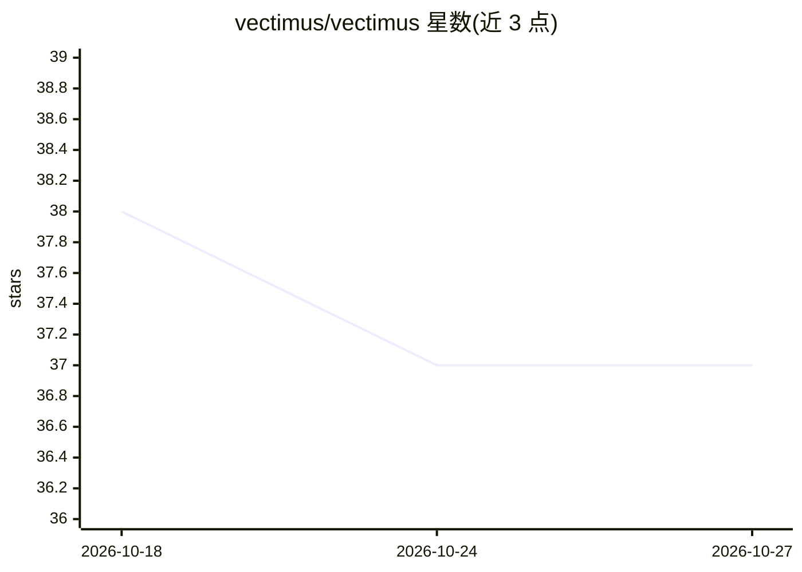

# vectimus/vectimus

⭐ 37 · Python · Apache-2.0 · 推送 2026-10-01 · [GitHub](https://github.com/vectimus/vectimus) · [官网](https://vectimus.com/) · 组织维护

**AI 编程代理的安全治理层：用 Cedar 策略拦截代理动作**

以 Cedar 策略引擎为核心的治理工具：在执行前拦截 AI 编程工具（Claude Code、Cursor、GitHub Copilot、Gemini CLI、Codex CLI）与代理框架（LangGraph、Google ADK、Claude Agent SDK）的工具调用，按确定性规则允许或拒绝。提供 11 个策略包覆盖破坏性命令、密钥访问、供应链攻击、MCP 治理等场景，规则映射 OWASP Agentic Top 10、SOC 2、NIST 等合规框架。支持观察模式、审计日志、Ed25519 签名回执与团队共享服务器模式。评估全本地运行，无 LLM 参与判定。

## 筛选速览

| 维度 | 判定 | 备注 |
|---|---|---|
| AI 角色 | `ai-ecosystem` | LLM/agent 周边工具 |
| 许可风险 | `permissive` | Apache-2.0 |
| 部署形态 | `library` | 以包/库形式分发 |
| 模型依赖 | — | README 未给出锁定关系 |
| 硬件要求 | — | 无带数字的原话,不猜 |
| 安装摩擦 | `low` | 无编译、无系统依赖或容器化 |
| 成熟度 | `idea` | |

## 能力要点

- Cedar 确定性策略评估，无 LLM 参与判定，宣称单次评估低于 10ms
- 11 个策略包覆盖破坏性操作、密钥、供应链、MCP 治理等 11 类风险
- MCP 服务器默认全部拦截，通过 allowlist 审批管理
- 支持观察模式、审计日志与 Ed25519 签名回执（可离线验证）

## 适用场景

- 拦截 AI 编程代理的破坏性命令与未审核的基础设施变更
- 为团队代理部署提供集中式策略评估与审计日志
- 按 OWASP/SOC 2/NIST 等框架留存合规证据

## 场景标签

`网络安全` · 领域:学习与行业

## 证据(README 行号)

> L19: That's it. Cedar policies evaluate every tool call - whether from a coding agent in your terminal or a framework ag
> L160: - **Vectimus** translates tool-specific payloads (Claude Code, Cursor, Copilot, Gemini CLI and Codex CLI) into a u
> L161: - **Cedar Engine** evaluates all loaded policies deterministically. No LLM in the loop. Same input, same decision.

## 星数曲线

2026-10-18 38 → 2026-10-27 37（-1）

---
*卡片 v1 · prompt 1.4 · 生成 2026-10-25 · 置信度 high · 依据 README sha `d4cd1756ea56` · [字段定义](../../DATASET.md)*
