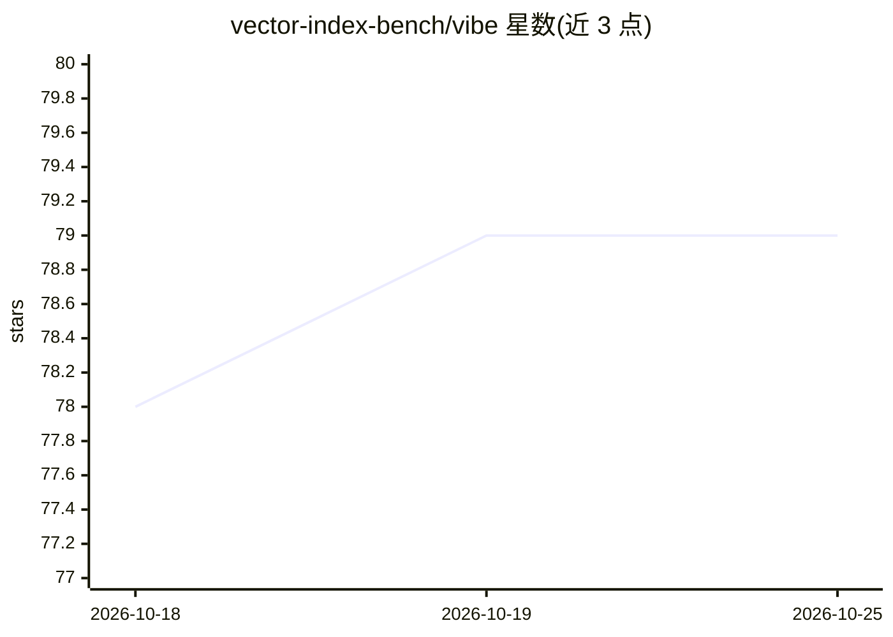

# vector-index-bench/vibe

⭐ 79 · Python · MIT · 推送 2026-09-23 · [GitHub](https://github.com/vector-index-bench/vibe) · [官网](https://vector-index-bench.github.io) · 组织维护

**向量索引（ANN 检索）算法的可扩展基准测试框架**

面向近似最近邻搜索（ANN）算法的基准测试套件：在多个现代嵌入数据集（文本、图像、文到图、多向量、注意力向量，覆盖分布内/分布外设定）上对 HNSW、Faiss IVF、ScaNN、DiskANN 等 30 种向量索引算法实现进行评测，支持 8 位整数量化与二进制数据集、GPU 算法、Slurm/NUMA 的 HPC 环境。评测基于 Apptainer/Singularity 容器运行，提供 run.py、绘图与数据集重建脚本；官方结果发布于配套网站。明确声明不评测向量数据库或云服务。

## 筛选速览

| 维度 | 判定 | 备注 |
|---|---|---|
| AI 角色 | `ai-ecosystem` | LLM/agent 周边工具 |
| 许可风险 | `permissive` | MIT |
| 部署形态 | `None` |  |
| 模型依赖 | — | README 未给出锁定关系 |
| 硬件要求 | — | 无带数字的原话,不猜 |
| 安装摩擦 | `low` | 无编译、无系统依赖或容器化 |
| 成熟度 | — | 结构信号不足 |

## 能力要点

- 收录 30 种向量搜索算法实现进行算法级对比
- 11 个分布内 + 8 个分布外嵌入数据集，另有 5 个弃用数据集仍可访问
- 支持 8-bit/二进制量化数据集与 GPU 算法
- 支持 Slurm/NUMA 的 HPC 环境与 Apptainer 容器化运行

## 适用场景

- 为向量检索场景选型时对比各 ANN 算法的召回与性能
- 在 HPC 集群上复现或扩展向量索引基准结果
- 将自己的 ANN 算法或新数据集加入基准评测

## 场景标签

`模型评测` · 领域:评测与运维

## 证据(README 行号)

> L3:  Vector Index Benchmark for Embeddings (VIBE) is an extensible benchmark for approximate nearest neighbor search met
> L14: - 🏆 Includes the most comprehensive collection of state-of-the-art vector search algorithms
> L20: VIBE compares approximate nearest neighbor search algorithms, typically with one representative high-performing imp

## 星数曲线

2026-10-18 78 → 2026-10-25 79（+1）

---
*卡片 v1 · prompt 1.4 · 生成 2026-10-24 · 置信度 high · 依据 README sha `05b496fcfba9` · [字段定义](../../DATASET.md)*
