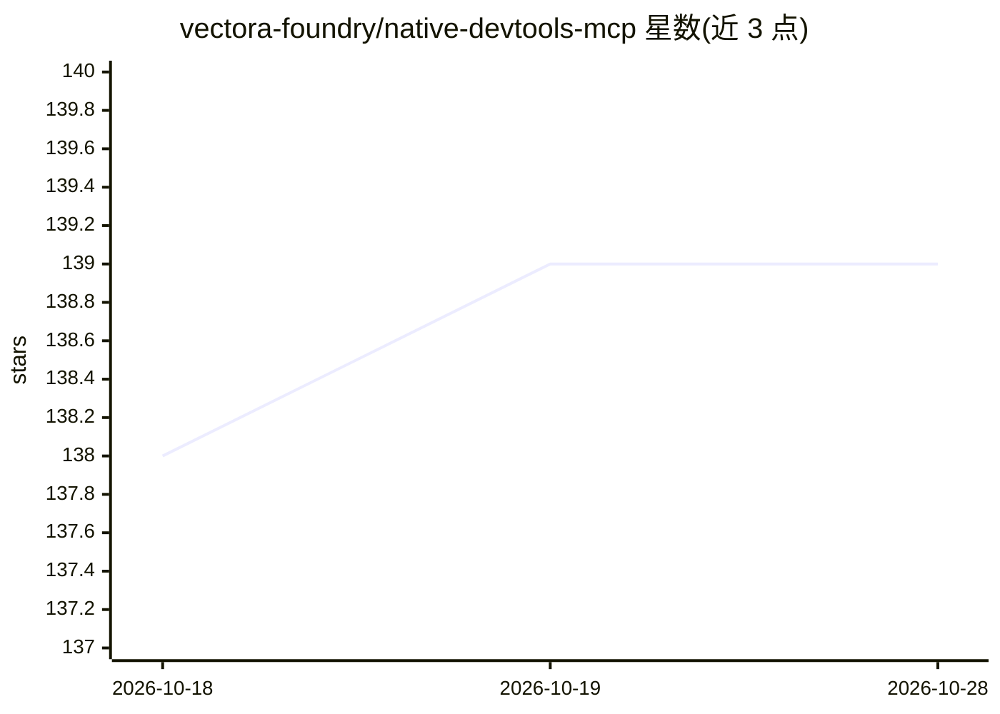

# vectora-foundry/native-devtools-mcp

⭐ 140 · Rust · MIT · 推送 2026-09-24 · [GitHub](https://github.com/vectora-foundry/native-devtools-mcp) · [官网](https://www.npmjs.com/package/native-devtools-mcp) · 组织维护

**本地 MCP 服务器：让 AI agent 操控桌面、浏览器与安卓设备**

面向 AI agent 与 MCP 客户端的本地服务器，提供截图与内置 OCR、点击/输入模拟、macOS 辅助功能树精准派发、Chrome/Electron 的 CDP 浏览器自动化（21 个 CDP 工具）、ADB 安卓设备控制与模板匹配，覆盖 macOS 与 Windows。支持 Claude Desktop、Claude Code、Cursor 等 MCP 客户端，通过 npx/npm 安装，macOS 需辅助功能与屏幕录制权限。限制：不支持 Linux 与 iOS，仅 Chrome/Electron，仅限有头模式。

## 筛选速览

| 维度 | 判定 | 备注 |
|---|---|---|
| AI 角色 | `ai-ecosystem` | LLM/agent 周边工具 |
| 许可风险 | `permissive` | MIT |
| 部署形态 | `desktop` | 安装包/桌面程序 |
| 模型依赖 | locked-api |  |
| 硬件要求 | — | 无带数字的原话,不猜 |
| 安装摩擦 | `medium` | 含编译或系统依赖之一 |
| 成熟度 | — | 结构信号不足 |

## 能力要点

- 截图 + OCR + 模板匹配的视觉自动化路径
- macOS AX Dispatch 不移动鼠标、不抢焦点
- Chrome/Electron CDP 提供 21 个 DOM 级工具
- ADB 控制 Android 设备（USB/Wi-Fi）

## 适用场景

- 让 Claude/Cursor 等 agent 操控原生桌面应用
- 对 Electron 应用做 DOM 级自动化
- 通过 ADB 操控和测试 Android 设备

## 场景标签

`浏览器自动化` `GUI 自动化` · 领域:效率与自动化

## 证据(README 行号)

> L17: `native-devtools-mcp` gives AI agents and MCP clients direct control over native desktop apps, Chrome/Electron brow
> L3: > **An MCP server for computer use on native desktop and mobile apps — macOS, Windows, Android, and Chrome/Electron 

## 星数曲线

2026-10-18 138 → 2026-10-28 139（+1）

---
*卡片 v1 · prompt 1.4 · 生成 2026-10-22 · 置信度 high · 依据 README sha `084b2216d38c` · [字段定义](../../DATASET.md)*
