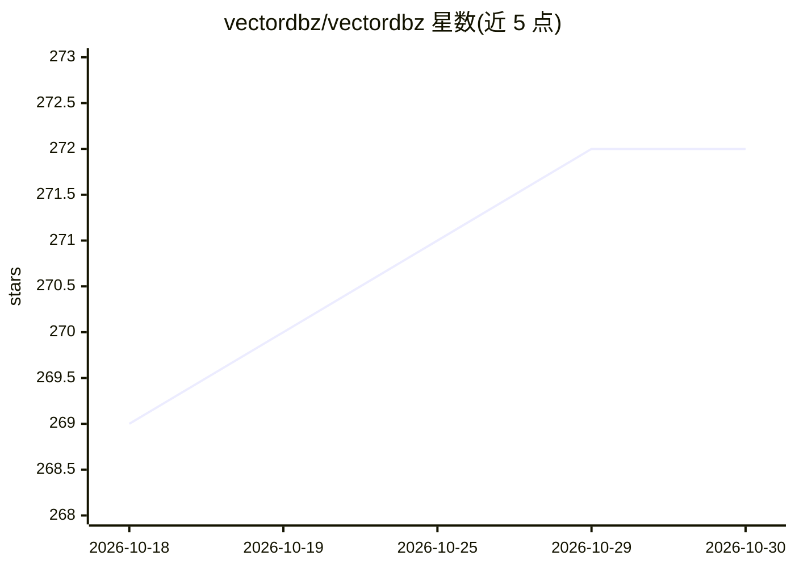

# vectordbz/vectordbz

⭐ 272 · TypeScript · MIT · 推送 2026-10-06 · [GitHub](https://github.com/vectordbz/vectordbz) · [官网](http://vectordbz.com/) · 组织维护

**开源向量数据库桌面管理客户端：连接、浏览、搜索与可视化**

跨平台桌面应用，用于连接本地或云端向量数据库实例：浏览 collection、执行向量与混合搜索、以 2D/3D 可视化 embedding，支持 Qdrant、Weaviate、Milvus、ChromaDB、Pinecone、pgvector、Elasticsearch、RedisSearch、Ahnlich 共 9 种数据库及各自最低版本要求。安装途径含 Homebrew cask（macOS）、各平台安装包（Windows exe、macOS zip、Linux deb/rpm）与 npm 源码运行；macOS 应用未签名，需手动放行。MIT 许可。

## 筛选速览

| 维度 | 判定 | 备注 |
|---|---|---|
| AI 角色 | `ai-ecosystem` | LLM/agent 周边工具 |
| 许可风险 | `permissive` | MIT |
| 部署形态 | `desktop` | 安装包/桌面程序 |
| 模型依赖 | — | README 未给出锁定关系 |
| 硬件要求 | — | 无带数字的原话,不猜 |
| 安装摩擦 | `low` | 无编译、无系统依赖或容器化 |
| 成熟度 | — | 结构信号不足 |

## 能力要点

- 支持 9 种向量数据库并标注各自最低版本
- 向量/混合搜索与 embedding 2D/3D 可视化
- 提供 macOS/Windows/Linux 桌面安装包与 Homebrew cask

## 适用场景

- 在图形界面中管理本地或云端向量数据库的 collection
- 调试向量与混合搜索结果并可视化 embedding 分布
- 在不部署额外基础设施的情况下浏览多种向量数据库

## 场景标签

 · 领域:数据库工具/AI 基础设施

## 证据(README 行号)

> L13: VectorDBZ lets you connect to local or cloud vector database instances, explore collections, run vector and hybrid 
> L15: ## Supported Databases

## 星数曲线

2026-10-18 269 → 2026-10-30 272（+3）

---
*卡片 v1 · prompt 1.4 · 生成 2026-10-22 · 置信度 high · 依据 README sha `d556a28af7e6` · [字段定义](../../DATASET.md)*
