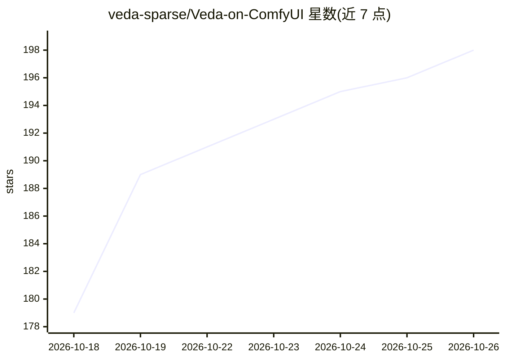

# veda-sparse/Veda-on-ComfyUI

⭐ 198 · Python · MIT · 推送 2026-10-11 · [GitHub](https://github.com/veda-sparse/Veda-on-ComfyUI) · [官网](https://veda-sparse.github.io/) · 组织维护 · 中文 README

**ComfyUI 节点：用学习式稀疏注意力加速 MiniMax-H3 视频生成**

将 Veda 学习式稀疏注意力方法打包为 ComfyUI 自定义节点，作用于 MiniMax-H3（T2VA/FL2VA/R2VA）视频扩散模型。通过 275MB 蒸馏预测器预先判定注意力图中关键分块，仅计算约 top 10% 而跳过其余，以 attention override 方式接入，保留 LoRA、量化与条件输入等补丁的兼容性；内核随节点附带 Triton（NVIDIA SM80+、AMD RDNA3/4）与 MLX（Apple silicon）支持。需 ComfyUI >= 0.38.0，经 Comfy Registry 或克隆到 custom_nodes 安装。发布版预测器仅覆盖特定分辨率与时长，其他尺寸回退到最近邻 tile plan。

## 筛选速览

| 维度 | 判定 | 备注 |
|---|---|---|
| AI 角色 | `ai-ecosystem` | LLM/agent 周边工具 |
| 许可风险 | `permissive` | MIT |
| 部署形态 | `None` |  |
| 模型依赖 | — | README 未给出锁定关系 |
| 硬件要求 | — | 无带数字的原话,不猜 |
| 安装摩擦 | `low` | 无编译、无系统依赖或容器化 |
| 成熟度 | — | 结构信号不足 |

## 能力要点

- 一个节点接入：MODEL 进、MODEL 出，不修改权重
- 按 README 数据：RTX 5070 上端到端 2.9x、注意力 7.1x 加速
- 内核自检，无法运行时停止并给出原因而非静默降级
- 支持 NVIDIA SM80+ / AMD RDNA3、RDNA4 (ROCm) / Apple silicon (MLX)

## 适用场景

- 在 ComfyUI 中加速 MiniMax-H3 长视频片段生成
- 保留 Turbo/风格 LoRA 与量化 checkpoint 的前提下降低注意力开销
- 按需控制生成视频与参考图的稀疏度及保留全注意力的层与步

## 场景标签

`视频生成` · 领域:内容生成

## 证据(README 行号)

> L14: This repository packages Veda as a custom node for ComfyUI's native
> L15: MiniMax-H3 (T2VA, FL2VA and R2VA): one node, MODEL in and MODEL out.

## 星数曲线

2026-10-18 179 → 2026-10-26 198（+19）

---
*卡片 v1 · prompt 1.4 · 生成 2026-10-22 · 置信度 high · 依据 README sha `525476ef089f` · [字段定义](../../DATASET.md)*
