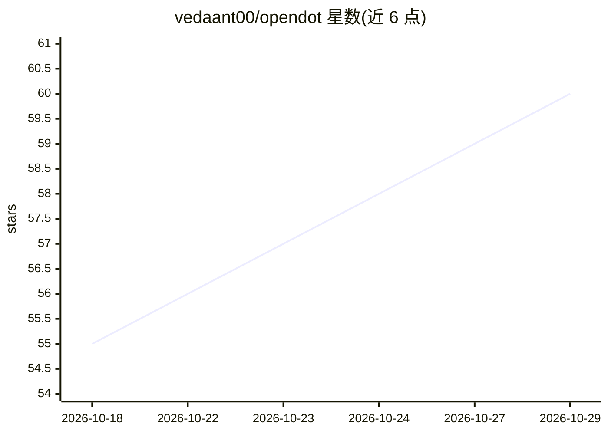

# vedaant00/opendot

⭐ 60 · Python · MIT · 推送 2026-10-15 · [GitHub](https://github.com/vedaant00/opendot) · [官网](https://pypi.org/project/opendot) · 个人维护

**可完全撤销的终端 AI agent：文件与 shell 操作先快照再执行**

交互式终端 AI agent，直接操作真实文件与 shell：每个动作执行前先快照到内容寻址存储，记录于 append-only 账本，支持 undo/redo/diff 与 resume；分类器区分工作区内与越界命令，越界（网络、sudo、git push 等）先确认并标记不可撤销。模型无关：通过 LiteLLM 接 OpenAI/Anthropic/Google/DeepSeek/Groq 等，或 Ollama 本地运行，也支持 llama.cpp/vLLM 等 OpenAI 兼容服务器。另提供预算上限（--usd/--tokens）、权限策略（--allow/--deny）、Docker 沙箱模式、MCP 客户端与 Composio 1000+ 应用工具接入。限制：分类器为启发式非安全边界，离开机器的效果不可撤销。

## 筛选速览

| 维度 | 判定 | 备注 |
|---|---|---|
| AI 角色 | `ai-native` | 本体是模型或模型工具 |
| 许可风险 | `permissive` | MIT |
| 部署形态 | `library` | 以包/库形式分发 |
| 模型依赖 | local-ok | 支持本地模型 |
| 硬件要求 | — | 无带数字的原话,不猜 |
| 安装摩擦 | `low` | 无编译、无系统依赖或容器化 |
| 成熟度 | — | 结构信号不足 |

## 能力要点

- 文件与 shell 动作全部先快照，undo/redo/diff/resume 可回滚
- 通过 LiteLLM 接任意模型，Ollama 可零配置本地运行
- 预算上限（--usd/--tokens）与权限策略（--allow/--deny，deny 优先）
- MCP 客户端 + Composio 1000+ 应用工具，--sandbox 容器隔离执行

## 适用场景

- 让 agent 重构代码或修测试失败后一键回滚到任意步骤
- CI 或无人值守运行时设定预算与命令白名单/黑名单
- 接入 MCP 服务器与 Gmail/Slack 等应用工具扩展 agent 能力

## 场景标签

`编码 Agent` · 领域:编码与开发

## 证据(README 行号)

> L15: opendot works directly on your real files and shell — but unlike other terminal
> L25: opendot is model-agnostic — it works with any model through LiteLLM (OpenAI,

## 星数曲线

2026-10-18 55 → 2026-10-29 60（+5）

---
*卡片 v1 · prompt 1.4 · 生成 2026-10-24 · 置信度 high · 依据 README sha `6c68eb5ffe1c` · [字段定义](../../DATASET.md)*
