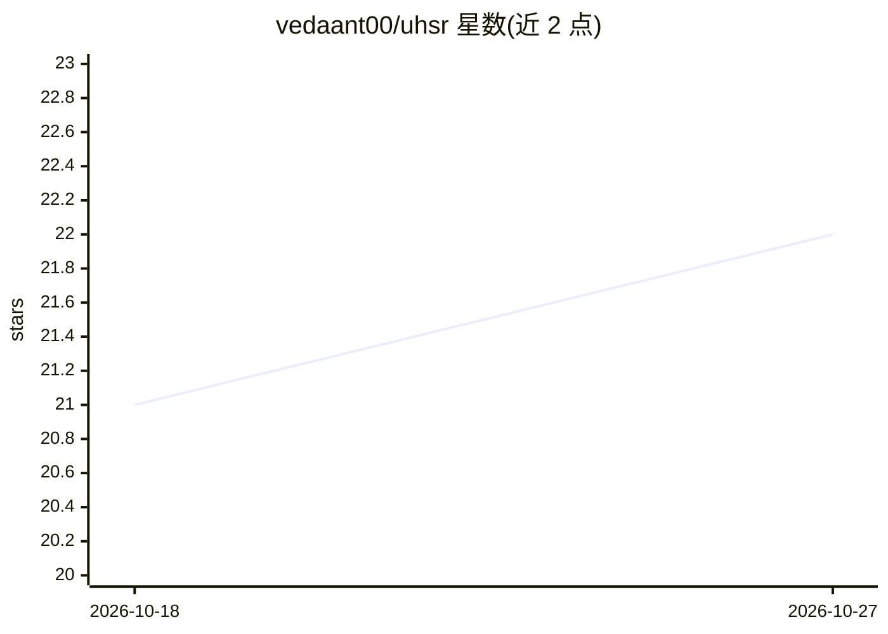

# vedaant00/uhsr

⭐ 22 · Python · MIT · 推送 2026-04-15 · [GitHub](https://github.com/vedaant00/uhsr) · 个人维护

**混合文本检索框架：BM25+向量检索与谱重排序融合打分**

Python 检索库，将 BM25 词法检索与 FAISS（本地）/Pinecone（云端）向量语义检索结合，经逻辑归一化与调和融合打分，再用 Graph Laplacian 与 Fiedler 向量做谱重排序，输出 [0,1] 区间的可解释相关性分数。支持 cosine、euclidean、mahalanobis 等 7 种相似度度量，可选用 Hugging Face Cross-Encoder 或 OpenAI 模型做二次重排。通过 pip 安装，GPU 与 Pinecone/OpenAI 均为可选组件。

## 筛选速览

| 维度 | 判定 | 备注 |
|---|---|---|
| AI 角色 | `ai-ecosystem` | LLM/agent 周边工具 |
| 许可风险 | `permissive` | MIT |
| 部署形态 | `library` | 以包/库形式分发 |
| 模型依赖 | — | README 未给出锁定关系 |
| 硬件要求 | — | 无带数字的原话,不猜 |
| 安装摩擦 | `low` | 无编译、无系统依赖或容器化 |
| 成熟度 | — | 结构信号不足 |

## 能力要点

- BM25 与稠密向量检索的混合管线
- Graph Laplacian + Fiedler 向量的谱重排序
- 分数逻辑归一化到 [0,1] 可解释区间
- 7 种相似度度量与可选 HF/OpenAI 重排器

## 适用场景

- 为检索增强应用构建混合检索管线
- 需要可解释归一化相关性分数的文本检索
- 本地 FAISS 或云端 Pinecone 两种部署方式间切换

## 场景标签

`语义搜索` · 领域:知识与检索

## 证据(README 行号)

> L6: UHSR is a **next-generation hybrid text retrieval model** that seamlessly integrates **lexical search (BM25)** and *
> L33: |🔹 **Semantic Search**|FAISS (local) or Pinecone (cloud-based) vector search|

## 星数曲线

2026-10-18 21 → 2026-10-27 22（+1）

---
*卡片 v1 · prompt 1.4 · 生成 2026-10-27 · 置信度 high · 依据 README sha `72727c10a994` · [字段定义](../../DATASET.md)*
