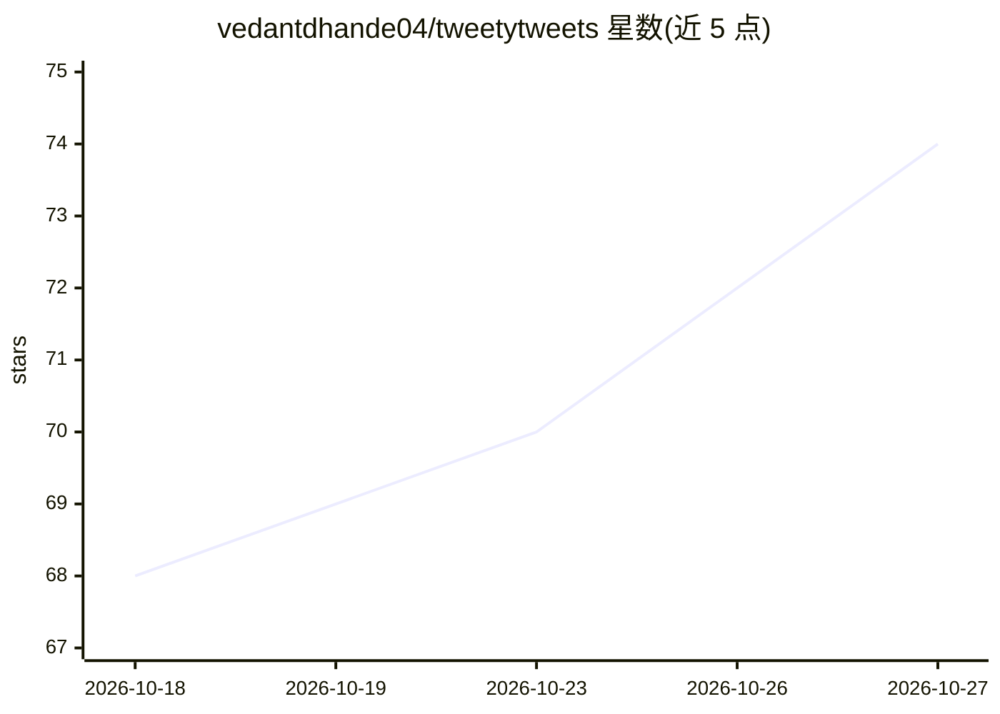

# vedantdhande04/tweetytweets

⭐ 74 · Python · MIT · 推送 2026-10-02 · [GitHub](https://github.com/vedantdhande04/tweetytweets) · 个人维护

**供 AI agent 使用的自主 X/Twitter 发帖流水线（免 API key）**

一套 Python 脚本流水线，供能运行 shell 命令的 AI agent（如 Claude Code、Cursor、Codex）调用：每日从 Hacker News、RSS、Reddit、X 搜索抓取约 150 条素材并排序，agent 阅读原文后按用户的语言画像（voice profile）撰写草稿，经 cron 门控后通过 Chrome DevTools Protocol 驱动真实已登录浏览器在 X 编辑器发帖，并用视觉模型回读主页截图验证发布成功。仅依赖 websockets 库，无需 X API key；README 明确指出浏览器自动化违反 X 的自动化规则，存在封号风险。

## 筛选速览

| 维度 | 判定 | 备注 |
|---|---|---|
| AI 角色 | `ai-native` | 本体是模型或模型工具 |
| 许可风险 | `permissive` | MIT |
| 部署形态 | `library` | 以包/库形式分发 |
| 模型依赖 | — | README 未给出锁定关系 |
| 硬件要求 | — | 无带数字的原话,不猜 |
| 安装摩擦 | `low` | 无编译、无系统依赖或容器化 |
| 成熟度 | — | 结构信号不足 |

## 能力要点

- 五阶段流水线：research → plan → schedule → publish → verify
- 通过 Chrome DevTools Protocol 驱动真实浏览器发帖，无需 X API key
- 基于用户历史最佳帖子的量化语言画像（voice profile）撰写草稿
- 代码级护栏：账号校验、长度守卫、验证后关闭、重试上限、过期撤稿

## 适用场景

- 让我的 AI agent 每天自动研究并发布符合我个人风格的 X 帖子
- 绕开 X API 费用，用浏览器自动化方式低成本持续发帖
- 带来源验证地生成每日新闻汇总帖

## 场景标签

`浏览器自动化` `AI 写作` · 领域:效率与自动化

## 证据(README 行号)

> L5: It researches the day's news in your niche, writes posts in *your* voice, publishes
> L31: |**Plan**|Your agent reads the swipe file, picks stories, **opens the actual source article**, and writes one post 
> L33: |**Publish**|Types into the real X composer over Chrome DevTools Protocol, respecting the account's true character 

## 星数曲线

2026-10-18 68 → 2026-10-27 74（+6）

---
*卡片 v1 · prompt 1.4 · 生成 2026-10-24 · 置信度 high · 依据 README sha `f0b024fcc95d` · [字段定义](../../DATASET.md)*
