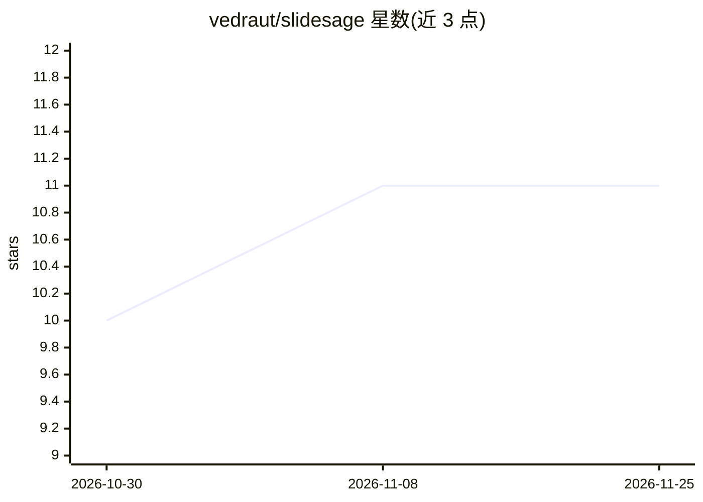

# vedraut/slidesage

⭐ 11 · JavaScript · MIT · 推送 2026-11-14 · [GitHub](https://github.com/vedraut/slidesage) · 个人维护

**agent 技能：用 LLM 生成叙事化静态 .pptx 演示文稿**

以 SKILL.md 形式提供的 agent 无关技能：LLM 按契约生成 storyboard JSON（目标、概念依赖 DAG、叙事弧、每页动作标题），再由确定性的 Node/PptxGenJS 渲染器输出静态 .pptx。提供 business（金字塔原理、MECE）与 education（布鲁姆目标、DAG 先修排序、检索练习）两种模式，六个视觉系统，并带 QA 门禁脚本校验标题、图表引用与目标覆盖。渲染阶段无需网络，可加 logo 与可选过渡动画。

## 筛选速览

| 维度 | 判定 | 备注 |
|---|---|---|
| AI 角色 | `ai-native` | 本体是模型或模型工具 |
| 许可风险 | `permissive` | MIT |
| 部署形态 | `library` | 以包/库形式分发 |
| 模型依赖 | — | README 未给出锁定关系 |
| 硬件要求 | — | 无带数字的原话,不猜 |
| 安装摩擦 | `low` | 无编译、无系统依赖或容器化 |
| 成熟度 | — | 结构信号不足 |

## 能力要点

- storyboard JSON 契约 + 确定性 PptxGenJS 渲染，输出跨 provider 一致
- business/education 双模式（金字塔原理 / 布鲁姆对齐 + DAG 排序）
- QA 门禁脚本自动拦截话题式标题、超载幻灯片、未引用图表等问题
- 六种机器可读的视觉风格令牌集，支持 --logo 加品牌标

## 适用场景

- 让 Claude / OpenAI Codex 等 agent 帮我生成 pitch 或报告演示文稿
- 为课程、讲座制作带教学设计结构的课件
- 需要固定视觉风格并自动做交付前质量检查的批量出片

## 场景标签

`AI 写作` · 领域:内容生成

## 证据(README 行号)

> L9: read a `SKILL.md`, write a JSON file, and run a shell command (Claude, OpenAI Codex, and compatible tools).
> L21: 1. The LLM reasons out a **storyboard** — a declarative JSON contract (`schemas/storyboard.schema.json`)

## 星数曲线

2026-10-30 10 → 2026-11-25 11（+1）

---
*卡片 v1 · prompt 1.4 · 生成 2026-11-18 · 置信度 high · 依据 README sha `a2aa700300a3` · [字段定义](../../DATASET.md)*
