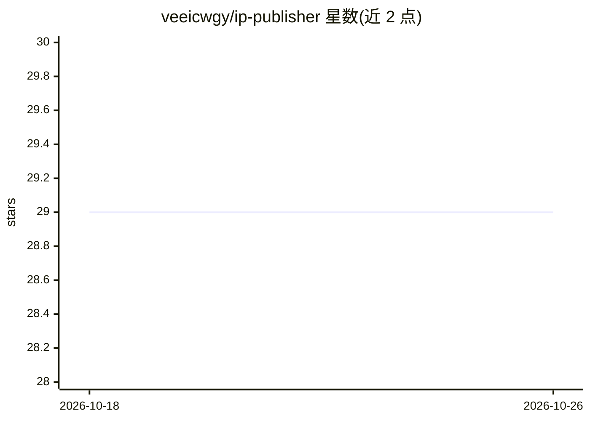

# veeicwgy/ip-publisher

⭐ 29 · Python · MIT · 推送 2026-04-23 · [GitHub](https://github.com/veeicwgy/ip-publisher) · [官网](https://ippublisher-lwukxvsq.manus.space/) · 个人维护 · 中文 README

**知识库驱动的多平台内容生成与审核工作流（中文 7 平台）**

面向产品/SEO 内容运营的 Python 工具：以知识库、SEO 关键词、热点线索和大纲为输入，生成主稿 article.md，先过审核闸门（事实可回溯知识库 chunk、关键词命中、结构完整性、平台规则），输出 audit_report.json、publish_package.json 和微信公众号/小红书/知乎/掘金/CSDN/头条/微博 7 平台内容文件。发布默认停在审核通过后的 Wechatsync 草稿同步信息，不托管账号密码、不自动登录直发。含轻量 humanizer 阶段与 legacy 模板模式入口。

## 筛选速览

| 维度 | 判定 | 备注 |
|---|---|---|
| AI 角色 | `ai-native` | 本体是模型或模型工具 |
| 许可风险 | `permissive` | MIT |
| 部署形态 | `None` |  |
| 模型依赖 | — | README 未给出锁定关系 |
| 硬件要求 | — | 无带数字的原话,不猜 |
| 安装摩擦 | `low` | 无编译、无系统依赖或容器化 |
| 成熟度 | — | 结构信号不足 |

## 能力要点

- 知识库优先生成：主稿从文档/FAQ/版本说明中找依据，关键声明回溯到 KB chunk
- 审核先于发布：grounding/keyword_fit/structure/platform_fit 等多维 audit_report.json
- 默认产出 canonical 7 平台内容包（微信/小红书/知乎/掘金/CSDN/头条/微博）
- 默认走 Wechatsync 草稿同步，不托管账号密码、不自动登录

## 适用场景

- 把产品知识库改造成适合 AI 检索和 SEO 分发的文章
- 同一主题一次拆出 7 个中文平台可用版本
- 先确保内容准确性和审核门槛，再进入草稿同步分发

## 场景标签

`工作流自动化` `RAG` `AI 写作` · 领域:效率与自动化

## 证据(README 行号)

> L12: > 把 **产品/工具知识库 + SEO 关键词 + 热点线索 + 大纲**，变成一套 **先审核、再分发** 的内容工作流：主稿、`audit_report.json`、`publish_package.json` 和 **7 
> L49: |产品/工具知识库、主关键词、热点线索、大纲、受众|基于知识库生成主稿，审核事实准确性/关键词命中/结构完整性/平台格式，再拆成 7 平台版本|`article.md`、`audit_report.json`、`publish_p
> L205: - 关键声明可以回溯到知识库 chunk

## 星数曲线

2026-10-18 29 → 2026-10-26 29（+0）

---
*卡片 v1 · prompt 1.4 · 生成 2026-10-26 · 置信度 high · 依据 README sha `067d73e127a0` · [字段定义](../../DATASET.md)*
