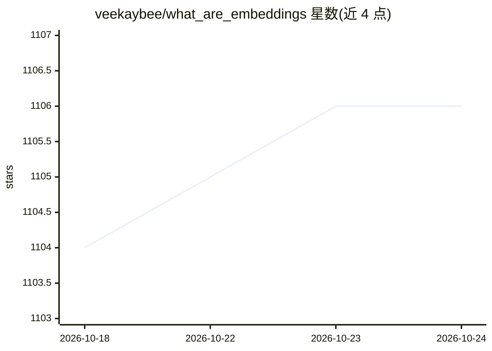

# veekaybee/what_are_embeddings

⭐ 1,106 · Jupyter Notebook · 推送 2026-01-17 · [GitHub](https://github.com/veekaybee/what_are_embeddings) · [官网](http://vickiboykis.com/what_are_embeddings/) · 个人维护

**embeddings 综述论文及配套网站与笔记本代码**

包含一份题为 What are Embeddings 的综述论文（LaTeX 文档）、生成的网站与配套 notebook 代码。论文梳理 embeddings 作为机器学习基础数据结构的历史与工业使用模式，内容涵盖 TF-IDF、PCA、Word2Vec 到 Transformer 与生成式方法的发展。LaTeX 文档在 Overleaf 编写、经 GitHub Actions 编译部署，notebooks 不受 CI 管理。面向希望系统了解 embeddings 原理与实践的读者。

## 筛选速览

| 维度 | 判定 | 备注 |
|---|---|---|
| AI 角色 | `ai-knowledge` | 知识聚合/清单类 |
| 许可风险 | `none` | — |
| 部署形态 | `None` |  |
| 模型依赖 | — | README 未给出锁定关系 |
| 硬件要求 | — | 无带数字的原话,不猜 |
| 安装摩擦 | `low` | 无编译、无系统依赖或容器化 |
| 成熟度 | — | 结构信号不足 |

## 能力要点

- embeddings 主题的综述论文，含历史与工业使用模式梳理
- 提供 LaTeX 文档、网站与配套 notebook 三种形式
- 通过 GitHub Actions 编译部署文档与网站

## 适用场景

- 系统学习 embeddings 的基础概念与发展脉络
- 了解工业界 embeddings 的常见使用模式
- 引用该综述（提供 DOI 与 bibtex 条目）

## 场景标签

 · 领域:机器学习/知识资源

## 证据(README 行号)

> L2: This repository contains the generated LaTex document, website, and complementary notebook code for
> L11: Google's Word2Vec paper made an important step in moving from simple statistical representations to semantic meanin

## 星数曲线

2026-10-18 1,104 → 2026-10-24 1,106（+2）

---
*卡片 v1 · prompt 1.4 · 生成 2026-10-21 · 置信度 high · 依据 README sha `707278a74a21` · [字段定义](../../DATASET.md)*
