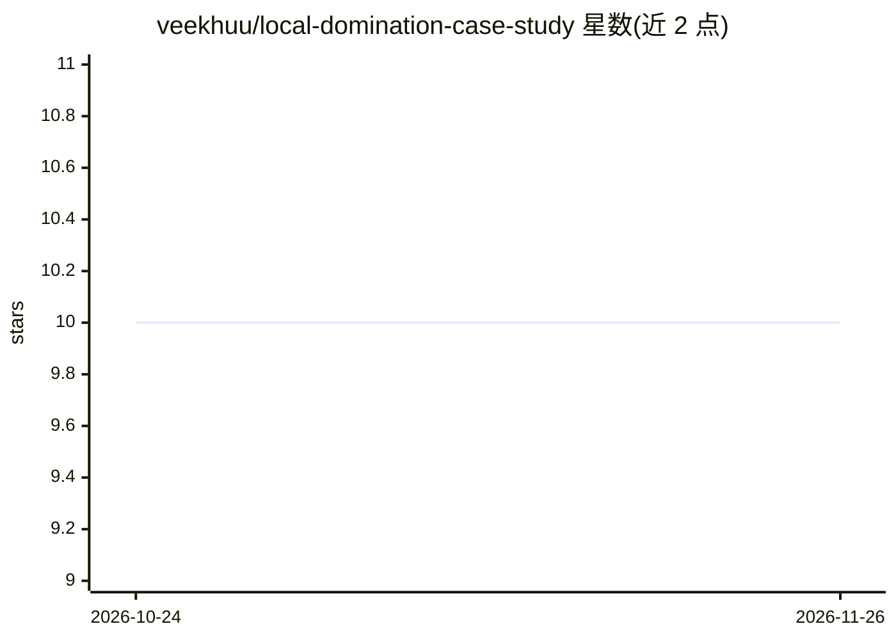

# veekhuu/local-domination-case-study

⭐ 10 · MIT · 推送 2026-03-11 · [GitHub](https://github.com/veekhuu/local-domination-case-study) · 个人维护

**用 AI 三天重建建筑公司网站的案例研究与完整实操手册**

一个案例研究仓库：记录作者基于 @boringmarketer 的 Local Domination Blueprint，用 AI 工具在 3 天内重建一家湾区定制住宅建筑公司网站的过程，规模为 550+ 页面、总花费约 $500、桌面端 PageSpeed 97 分。仓库按阶段整理工具清单与费用明细（tools.md、/docs 目录），并记录改进反思（关键词研究数据、图片批量转换、移动端优先、上线前装分析）。定位为 SEO/AEO 实操教程文档，非可安装的软件产品。

## 筛选速览

| 维度 | 判定 | 备注 |
|---|---|---|
| AI 角色 | `ai-knowledge` | 知识聚合/清单类 |
| 许可风险 | `permissive` | MIT |
| 部署形态 | `None` |  |
| 模型依赖 | — | README 未给出锁定关系 |
| 硬件要求 | — | 无带数字的原话,不猜 |
| 安装摩擦 | `low` | 无编译、无系统依赖或容器化 |
| 成熟度 | — | 结构信号不足 |

## 能力要点

- 550+ 页面、约 $500、3 天的完整建站流程记录
- 按阶段整理的工具清单与费用明细表
- AEO（在 ChatGPT/Perplexity 等 AI 搜索中出现）策略文档
- 基于 Local Domination Blueprint 的增量做法全部收录在 /docs

## 适用场景

- 参考用 AI 工具快速重建本地企业网站
- 为本地服务类业务制定 SEO/AEO 内容策略
- 了解 AI 建站流程中各阶段的工具选型与花费

## 场景标签

`教程课程` · 领域:学习与行业

## 证据(README 行号)

> L1: # How I Rebuilt a Construction Company Website in 3 Days With AI
> L5: This is a case study and full playbook for how I rebuilt a real construction company's website using AI tools, based
> L48: Each addition is documented in detail in the `/docs` folder.

## 星数曲线

2026-10-24 10 → 2026-11-26 10（+0）

---
*卡片 v1 · prompt 1.4 · 生成 2026-11-19 · 置信度 high · 依据 README sha `f80e2b2a9366` · [字段定义](../../DATASET.md)*
