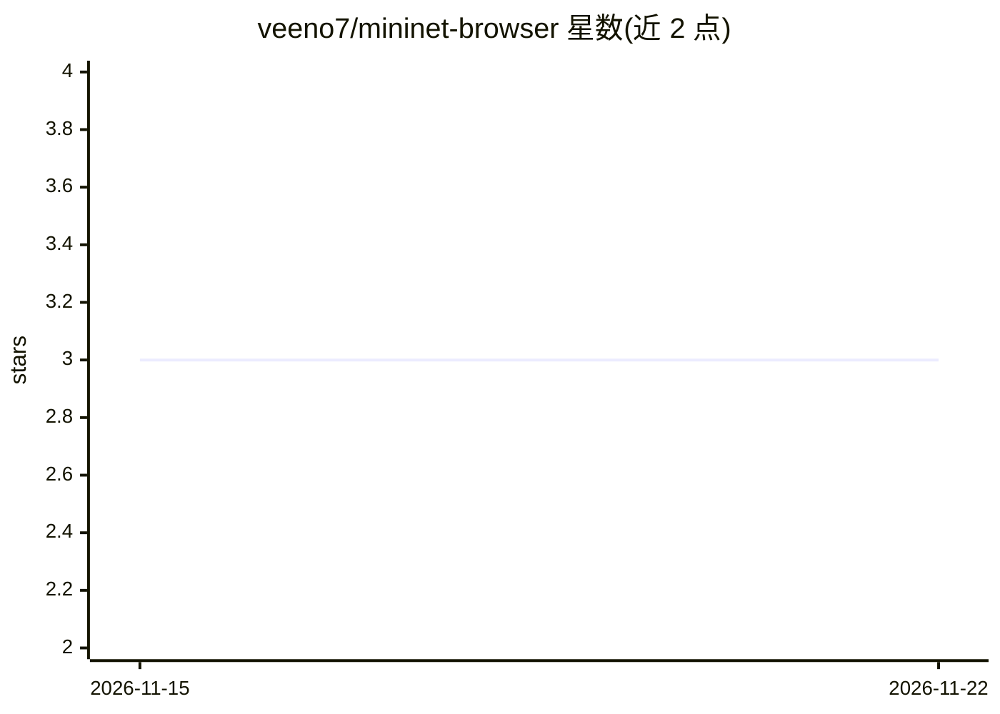

# veeno7/mininet-browser

⭐ 3 · JavaScript · MIT · 推送 2026-11-01 · [GitHub](https://github.com/veeno7/mininet-browser) · [官网](https://veeno7.github.io/mininet-browser/) · 个人维护

**让任意 AI 驱动的浏览器：多 AI 分标签操控网页，用户掌控审批**

基于 Electron 的桌面浏览器（Windows 安装包，可源码构建），通过 MCP 服务器向外部 AI 暴露 42 个工具：标签管理、点击输入、上传文件、截图、扩展管理等；支持 Claude、ChatGPT、Gemini、本地 Ollama 等模型同时接入，各自在独立标签页工作。内置 Orbit 助手支持自带 API key 或本地模型，含备用模型切换路由。每次 AI 操作需用户批准，任务以 mission 形式定义目标、预算与由浏览器自行校验的成功标准，并记录可回放的操作证据。核心代码对 AI 锁定，AI 只能操作网页与扩展。

## 筛选速览

| 维度 | 判定 | 备注 |
|---|---|---|
| AI 角色 | `ai-enhanced` | 去掉 AI 部分产品仍成立 |
| 许可风险 | `permissive` | MIT |
| 部署形态 | `desktop` | 安装包/桌面程序 |
| 模型依赖 | local-ok | 支持本地模型 |
| 硬件要求 | — | 无带数字的原话,不猜 |
| 安装摩擦 | `low` | 无编译、无系统依赖或容器化 |
| 成熟度 | — | 结构信号不足 |

## 能力要点

- 通过 MCP 向 Claude/ChatGPT/Cursor 等暴露 42 个浏览器操作工具
- 多个 AI 同时工作，各自独立标签页，Team view 并行展示
- mission 机制：浏览器自身校验成功标准，操作记录可回放
- 内置 Orbit 助手支持 BYOK（Claude/ChatGPT/Gemini/Groq/OpenRouter）或免费本地 Ollama

## 适用场景

- 让 AI 代我在网页上填表、发帖、上传视频等操作
- 多个 AI 助手并行分工处理浏览任务并实时监督
- 用免费本地 Ollama 模型作为兜底驱动浏览器任务

## 场景标签

`多智能体` `浏览器自动化` · 领域:Agent 开发

## 证据(README 行号)

> L17: Most AI assistants can talk about the web. MiniNet Browser lets them **use** it — click, type, shop, post, fill for
> L31: - 🔒 **Core is locked** — AI can only act on web pages and extensions. It can never change the browser's own code, r
> L32: - 🛡️ **Ad blocker, data saver, tabs, bookmarks, history, downloads, themes** — everything you expect from a modern 

## 星数曲线

2026-11-15 3 → 2026-11-22 3（+0）

---
*卡片 v1 · prompt 1.4 · 生成 2026-11-21 · 置信度 high · 依据 README sha `630fa6ff819d` · [字段定义](../../DATASET.md)*
