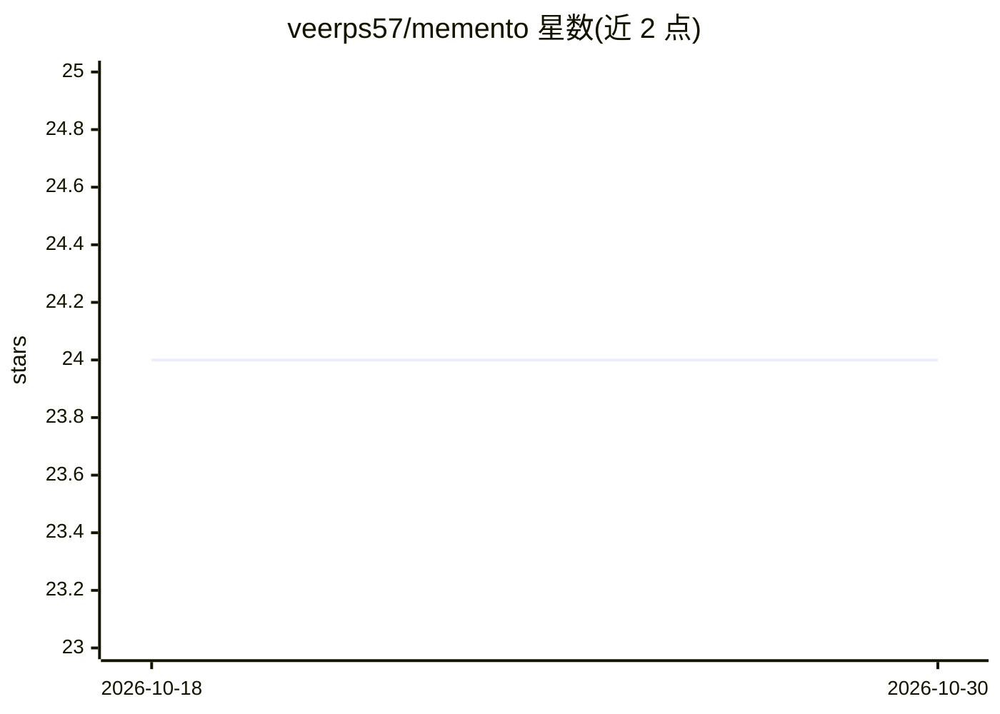

# veerps57/memento

⭐ 24 · TypeScript · Apache-2.0 · 推送 2026-05-17 · [GitHub](https://github.com/veerps57/memento) · [官网](https://runmemento.com/) · 个人维护

**给 AI 助手的本地优先、LLM 无关的记忆层**

通过 MCP 协议在本地 SQLite 文件上运行记忆服务，使 Claude Desktop、Claude Code、Cursor、GitHub Copilot、Cline、OpenCode 等 MCP 客户端可读写结构化记忆。记忆分 fact/preference/decision/todo/snippet 五类，每次写入产生追加式审计事件，冲突进入分诊流程，未确认记忆会衰减。默认无外呼网络、无遥测；检索采用 FTS 加向量双路，向量模型约 110MB 首次下载后启用，未下载时降级为 FTS。提供 npx 安装、交互式 init、记忆包分发与本地 dashboard。限制：不做聊天历史存储、非知识图谱、无云端同步与团队共享记忆。

## 筛选速览

| 维度 | 判定 | 备注 |
|---|---|---|
| AI 角色 | `ai-ecosystem` | LLM/agent 周边工具 |
| 许可风险 | `permissive` | Apache-2.0 |
| 部署形态 | `library` | 以包/库形式分发 |
| 模型依赖 | — | README 未给出锁定关系 |
| 硬件要求 | — | 无带数字的原话,不猜 |
| 安装摩擦 | `medium` | 含编译或系统依赖之一 |
| 成熟度 | — | 结构信号不足 |

## 能力要点

- MCP server 运行于本地 SQLite，单文件、默认无外呼网络
- 五类类型化记忆，追加式审计日志与冲突分诊
- FTS+向量双路检索，向量模型未就绪时降级为 FTS-only
- pack 机制以 YAML 捆绑分发记忆，带 pack:<id>:<version> 溯源标签
- regex scrubber 在持久化前剥离秘密信息，模式可配置

## 适用场景

- 让多个 AI 编程客户端共享同一份跨工具的偏好与决策记忆
- 在新会话中免去重复解释项目约定与上周决策
- 把团队/个人约定打包成记忆包在其他机器安装
- 在本地审计记忆来源、变更历史与冲突

## 场景标签

`Agent 记忆` · 领域:Agent 开发

## 证据(README 行号)

> L9: Memento is one place where that memory lives. It runs an MCP server over a local SQLite file, so any MCP-capable AI 
> L120: Plus: LLM-agnostic (works with whatever model your client talks to), MCP-native (Claude Desktop, Claude Code, Curs

## 星数曲线

2026-10-18 24 → 2026-10-30 24（+0）

---
*卡片 v1 · prompt 1.4 · 生成 2026-10-27 · 置信度 high · 依据 README sha `25332dec0469` · [字段定义](../../DATASET.md)*
